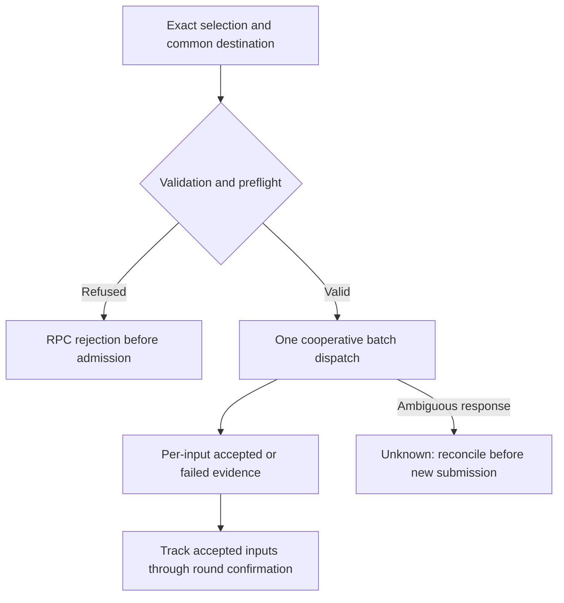

# Cooperative exit batches

`WalletService.ExitBatch` queues an exact selection of virtual transaction
outputs (VTXOs) in one cooperative round intent. Inputs may come from different
original rounds. This extends the wallet API over the existing daemon batch
operation. The singular `Exit` request and its explicit unilateral option keep
their existing contracts.

Use a separate RPC rather than adding a list to `Exit`: an older daemon could
ignore a new protobuf field and execute only the singular selection. An older
daemon returns `Unimplemented` for gRPC `ExitBatch` (REST has no matching
route). Clients must never emulate this capability by looping `Exit` or fall
back to unilateral exit.

## Admission and results

1. The wallet API parses the entire selection and rejects empty lists, empty or
   malformed entries, and duplicate parsed identities before address allocation.
   It canonicalizes each outpoint as `txid:index` and preserves request order.
2. The wallet snapshots the selected amounts before dispatch. An unavailable
   or incomplete snapshot refuses the request before any input is queued.
   An omitted destination allocates one fresh backing-wallet address for the
   entire request. A supplied destination is used for every selected input.
3. `LeaveVTXOs` validates the destination against the configured Bitcoin network
   and standard-script policy before any input reservation. Its strict explicit
   selection preflight rejects unknown, spent, spend-reserved or already committed
   inputs before dispatch. Expired inputs retain the existing reclaim policy.
4. The wallet loads each descriptor and pairs its amount with a leave output.
   Descriptor-load failures are per-input failures. Successfully loaded inputs
   are reserved together and sent in one `RegisterIntentMsg`, including under
   eager round joining. Reservation failure rolls back earlier reservations;
   round-registration failure requests reservation release.
5. The response contains one result per selected input, in request order. The
   daemon preserves per-input errors instead of discarding them at the RPC edge.
   When at least one input is positively accepted, `activity_id` identifies one
   aggregate EXIT row for that accepted subset. Unknown and rejected inputs are
   excluded. The composed intent settles as one round, so its shared round fee
   is recorded once rather than once per source input.

| Outcome | Meaning | Host action |
| --- | --- | --- |
| `accepted` | Queued into the local cooperative round intent. | Track wallet activity through confirmation or failure. |
| `failed` | Definitively not queued in this attempt. | Show the reason. Any later submission must exclude accepted inputs and reconcile unknown inputs first. |
| `unknown` | Dispatch failed ambiguously, or the daemon returned no admission evidence for this input. | Reconcile activity, input state and round state. Do not automatically resubmit. |

`InvalidArgument` and `FailedPrecondition` are pre-admission rejection codes.
`Unimplemented` means this daemon does not support batching. Other transport
errors can hide accepted work. A successful RPC can contain failed or unknown
inputs; hosts must inspect **every** result.

Accepted does not mean the operator admitted or confirmed the round. Partial
admission is possible. This API promises neither all-or-nothing execution nor
idempotency. The activity identifier is a tracking handle, not a replay key.
The existing activity store retains accepted principal and destination across
restart, and the existing reconciler advances the row on confirmed forfeit.
This adds no durable batch replay record, automatic retry, or new reconciliation
service. Never infer absence from a timeout, create a
replacement operation after an ambiguous response, or switch it to unilateral
exit. If activity and input state cannot establish the result, retain unknown
and ask for operator investigation.



## Outputs, fees and original rounds

A common destination does **not** consolidate the batch into one on-chain
output. Each admitted VTXO contributes its own leave output. Each input remains
subject to the existing operator fee policy. The round FSM chooses one change
marker over the fully composed intent and applies the aggregate fee at seal
time. `GetExitPlan` remains a unilateral recovery estimator; it does not quote
this cooperative request or authorize batch unilateral submission.

The aggregate activity holds the accepted inputs' gross principal while
pending. At confirmation it reports the net value delivered to the destination
as `amount_sat`, with the shared round fee recorded separately in `fee_sat`.

The wallet selection and reservation paths key by exact outpoint, not original
round ID. Each VTXO actor retains its own descriptor, ancestry, keys and expiry.
The new round consumes their forfeits together. `LiveState.handleForfeitRequest`
builds each forfeit from its own descriptor and that input's new connector;
`signForfeitVTXOInput` binds its amount and script in the signing hash. No
original-round equality check is introduced.

Tests cover distinct persisted origin round IDs through daemon admission,
distinct descriptor lifetimes and amounts through one wallet intent, reservation
rollback and registration release, and partial/unknown response handling.
`TestLeaveBatchCrossRoundRestart` seeds two finalized origin rounds, observes
both exact inputs in one eager operator JoinRound request, and verifies that
both orphan reservations return to live after restart without replaying the
batch. It uses a fake operator and does not prove confirmation of a mixed-origin
batch on a live network.

## Go SDK and mobile ABI

Go callers use:

```go
result, err := client.ExitBatch(ctx, wavewalletdk.ExitBatchRequest{
    Outpoints: []string{firstOutpoint, secondOutpoint},
    Destination: address, // Empty allocates one wallet-owned address.
})
```

Inspect `result.Results[i].Outcome` (`accepted`, `failed`, `unknown`) and `Error`.
`result.Destination` returns the common address. The SDK performs one batch RPC,
with no retry or fallback.

The gomobile ABI is `ExitBatch(reqJSON []byte) ([]byte, error)`. It uses the SDK's
PascalCase JSON field names, as other mobile wallet verbs do:

```json
{
  "Outpoints": ["<64-hex-txid>:0", "<another-64-hex-txid>:1"],
  "Destination": ""
}
```

```json
{
  "Results": [
    {"Outpoint": "<64-hex-txid>:0", "Outcome": "accepted", "Error": ""},
    {"Outpoint": "<another-64-hex-txid>:1", "Outcome": "unknown", "Error": "response lost"}
  ],
  "Destination": "<common-onchain-address>",
  "ActivityID": "<canonical-activity-id-for-accepted-subset>"
}
```

There is no `ForceUnrollAck` field. The call uses the active daemon lifecycle
context, like singular mobile `Exit`; stopping the daemon cancels it and can
leave the result unknown. The host must retain the exact selection before
submission and the destination once returned, keep the daemon alive during
submission, and reconcile uncertainty before allowing another funds-moving action
for those inputs.

## Browser WASM binding

The typed browser host SDK can call the private transport method
`wavewalletdkCall("exitBatch", request)`. It dispatches once through the same
`mobile.ExitBatch` facade. Requests and responses use the PascalCase JSON
fields shown above, and the returned promise resolves to the parsed result.

The host SDK owns lifecycle serialization and runtime locking. It must inspect
every input outcome after resolution. A rejected promise or an unknown outcome
requires reconciliation before a new submission; the bridge adds no retries or
unilateral fallback.

## CLI and REST

```sh
wavecli exit batch --outpoint TXID1:0 --outpoint TXID2:1
wavecli exit batch --outpoint TXID1:0 --outpoint TXID2:1 --onchain-address ADDRESS
```

`--dry-run` validates locally and prints the request. It does not test current
input availability or obtain an operator fee quote. The command prints all
results and returns an error when any input is failed or unknown. A zero exit
status means all inputs were queued locally, not confirmed.

The REST endpoint is `POST /v1/wallet/exit-batch`, using protobuf JSON
(`outpoints`, `onchain_address`, `results`, and enum names such as
`EXIT_BATCH_ACCEPTED`). It requires the same on-chain write permission
as singular `Exit`. The additive `activity_id` response field is empty when no
input is positively accepted; older clients can ignore it.

## Compatibility

| Client | Daemon | Behavior |
| --- | --- | --- |
| Existing singular client | New daemon | Existing `Exit` behavior. |
| New batch client | Old daemon | Unsupported method. No partial singular execution. |
| New batch client | New daemon | One cooperative request with per-input results. |

There is no database migration or operator protocol change. Queued work retains
the existing round/VTXO persistence and startup recovery. A request abandoned
before a durable round intent exists is not a resumable batch job. Startup's
orphaned-forfeit recovery may release reservations; it does not reconstruct a
lost batch selection or prove its payout. Upgrade the daemon/native SDK before
exposing multi-selection in a host UI.
