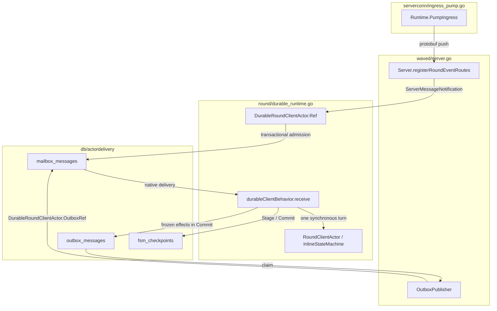
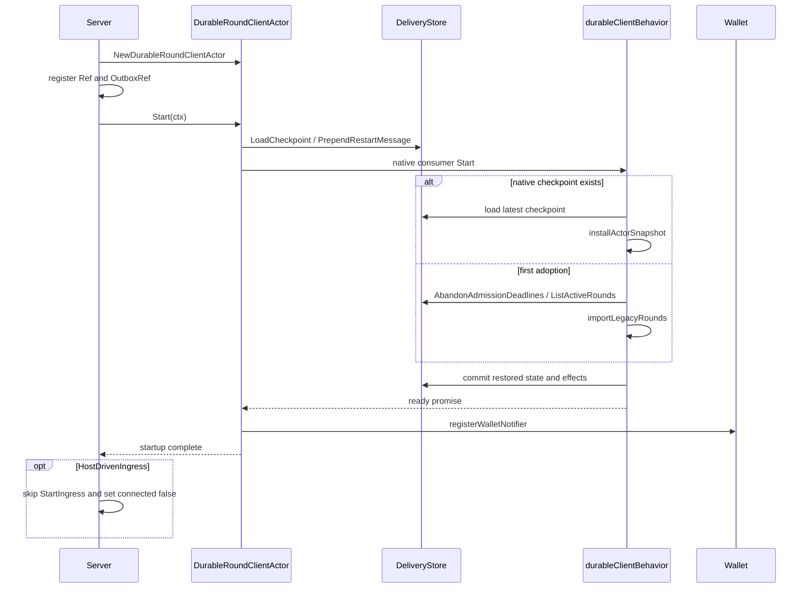
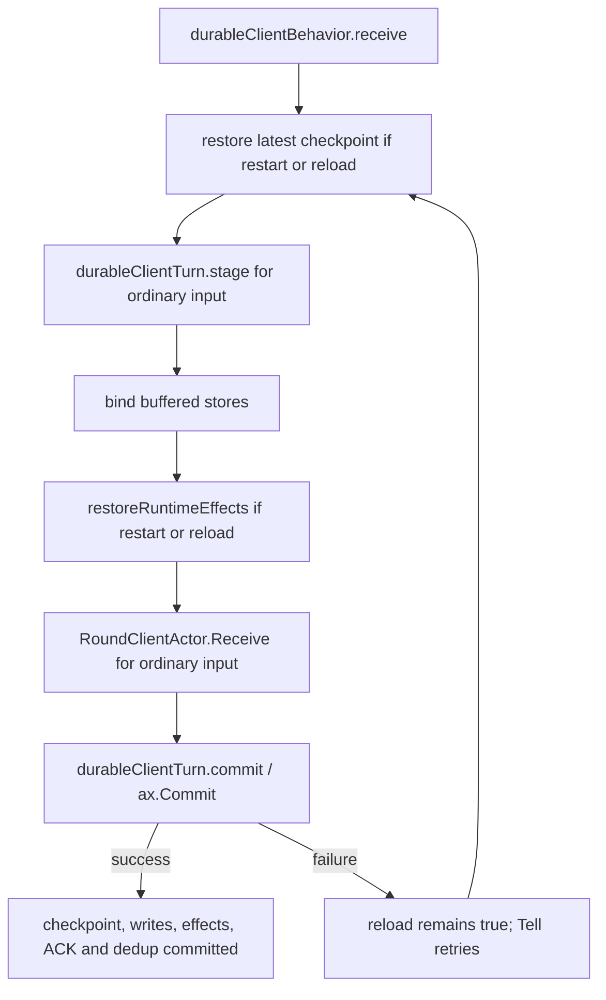
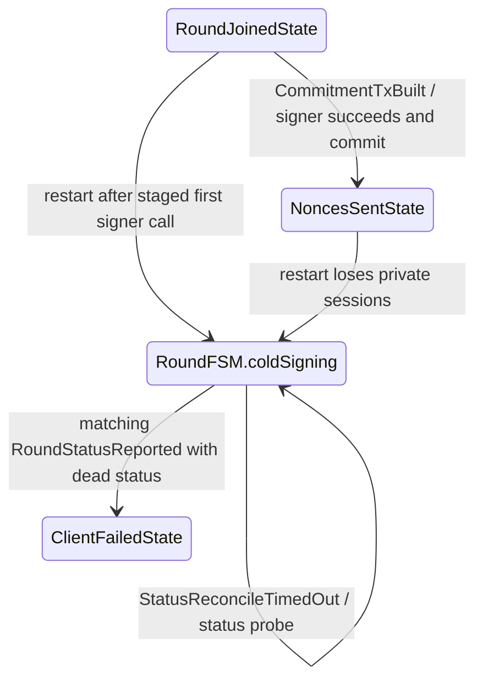
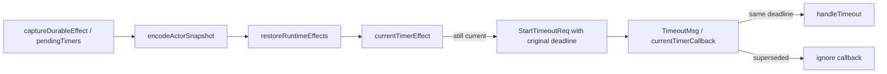
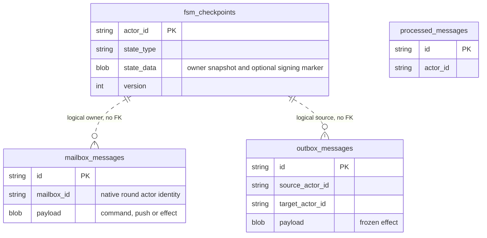

# Mobile Round Runtime Architecture

The persistent round runtime keeps accepted mailbox work, the client's round
state, and its planned outgoing effects in the same recovery boundary. This
document maps ownership and execution in the SDK runtime/recovery series at
`0f28b34e`. It covers `round`, the native actor store, and their `waved`
wiring. The implementation is tracked in [#1531](https://github.com/lightninglabs/wavelength/pull/1531), which remains the reference if the stack is rebased or squashed. It does not describe a completed mobile background executor.

For the native mailbox framework, see
[Durable Actor Architecture](durable_actor_architecture.md). For transport
acknowledgements and receipts, see [Mailbox Ingress Safety](mailbox_ingress_safety.md).

## Components

`DurableRoundRuntime` selects the persistent owner. The ordinary daemon keeps
the threaded round owner when this option is false. If a native round
checkpoint already exists, startup rejects the false setting; the host must
explicitly enable durable recovery. `HostDrivenIngress` leaves transport intake paused at startup;
the domain actors and shared outbox publisher still have independent lifetimes.
Local wallet-ready hooks, including swap recovery and canonical activity backfill,
run while ingress is paused. Authenticated operator policy refresh and persisted
Board replay run once after explicit foreground ingress starts. A failed or
cancelled policy read or Board replay leaves that online phase incomplete. The
host owns retries by calling `SetHostForeground(true)` again; native startup
does not schedule a retry. Board replay never uses the anonymous bootstrap
policy. Ordinary daemon startup keeps its original online-policy, best-effort
replay, then hook order.

| Component | Owns | Does not own |
| --- | --- | --- |
| `serverconn.Runtime` | Ingress ownership, cursor persistence and remote acknowledgement | Round completion or local actor quiescence |
| `DurableRoundClientActor` | Native consumer lifetime, typed ingress and outbox references, startup barrier | Push delivery or application scheduling |
| `durableClientBehavior` | Checkpoint version, failed-turn reload and final transaction boundary | Remote operator state |
| `RoundClientActor` | Round maps, confirmation routing, pending quotes, boarding queue and protocol turns | Durable mailbox leasing or outbox publication |
| `durableClientTurn` | Buffered final writes and frozen effects for one turn | Every store write or signer lifetime |
| `InlineStateMachine` | Event processing and the resulting internal-event chain | A separate runner goroutine |
| `OutboxPublisher` | Claim and handoff of committed effects | Completion of the recipient's external operation |

Durable join effects advertise `SupportsRoundRetry: false` before their wire
request is frozen. Current replacement-round lineage and retry self-messages
are outside the durable checkpoint. An outbox replay retains the disabled
capability; ordinary threaded clients still advertise replacement support.

## Startup and shutdown

Construction is inert. Both references must be registered before recovery can
publish effects or request wallet backlog. The recovery barrier precedes
notification registration so callbacks enter an initialized persistent inbox.
The typed receptionist lookup uses `round-client-service`. The generic outbox
adapter uses `round-client`, the unchanged persisted mailbox, checkpoint and
outbox address. Distinct names prevent the receptionist from rejecting the
second registration as a type mismatch.

The owner lifetime is independent of the caller's startup context. Successful
`StopAndWait` cancels and joins native delivery before `OnStop` cleans
process-local sessions. Failed startup uses the same stop-and-join path.
`Server` invokes it before stopping the shared publisher and closing storage.
If the shutdown budget expires, existing server cleanup logs the error and
continues; callers must not interpret that error as a successful join.

## One persistent turn

The native TxBehavior consumer has one worker and uses the leaseless path.
The same database must back the mailbox, round store, VTXO store and durable
ledger sink. Each participating store must honor the transaction in context.

1. **Restore.** `restore` reads the latest store checkpoint. It does not trust
   the checkpoint copied into an older queued restart message.
2. **Stage.** Ordinary input gets a before-image and encoded in-flight input.
   A signing command also records the owned round before the first signer call.
   Restart itself skips input staging.
3. **Run.** `bind` installs buffered stores. `Receive` drives an inline state
   machine through its complete internal-event chain. On restart or reload,
   `restoreRuntimeEffects` runs after `bind` and before `Receive` to re-arm
   process-local watches and saved effects. Signer I/O runs outside the
   database writer transaction.
4. **Commit.** `ax.Commit` combines buffered round/VTXO mutations, outbox rows,
   the new checkpoint, consumed input and the native deduplication marker.
5. **Recover.** A failed or panicked tentative turn leaves `reload` set.
   Redelivery installs the saved before-image before another turn proceeds.

Admission deadlines are a separate safety fence: `ConstrainAdmissionDeadline`
and `CloseAdmissionDeadline` are inherited store methods, not buffered final
writes. Owned-script registration and process-local watches also retain their
existing boundaries. This runtime does not claim that every write occurs in
the final transaction.

Synchronous Ask and asynchronous Tell have different failure contracts in the
native framework. An unsuccessful Ask returns an error to its caller; it is
not automatically retried. Remote mailbox dispatch uses durable Tell. Its
failed uncommitted turn remains eligible for retry under native policy.

## Signing interruption

Private MuSig2 sessions cannot be reconstructed from a public checkpoint.
`interruptedSigningRound` recognizes only a matching event and owned state.
Unknown, reaped, wrong-state and already-cold rounds do not acquire a new
signing marker.

`installRoundState` starts the restored inline runner without replaying entry
actions. Cold recovery retains the round and its reservations. Local timeout
or cancellation cannot establish that an old ceremony is absent. A matching
authoritative dead report permits failure and reservation release. Ordinary
signed-state recovery replays the exact saved input signatures through
`replayCheckpointedServerMessages`; it does not regenerate them.

The protocol state codec also classifies lost sessions in
`NoncesAggregatedState` and `PartialSigsSentState`. The diagram shows the
runtime's ownership rule, not the full round protocol. The protocol state union
and its field coverage live in `durable_state.go` and its tests.

## Timers, boarding queries and accounting

Recovery preserves absolute timer deadlines and the selected schedule window.
`runtime_timing.go` retains admission expiry and closed status, schedule
identity, selected slot, wake time and clock estimate. It never chooses a later
slot for an interrupted attempt. Wall-clock changes across process restarts
remain relevant to an absolute timestamp.

Accepting a current callback consumes its pending timer before the handler runs. A replacement scheduled by that handler remains pending. Final commit and recovery remove timers whose round has left the owner map.

The boarding queue and `boardFetchID` survive in the owner snapshot. Recovery
may repeat the wallet read. Its asynchronous reply carries the same correlation
identity; a late reply cannot remove a replacement queue head. Reads do not
perform funding or signing.

Finalization captures the ledger batch before removing the completed round
from the live maps. The deferred `FinalizeRound` callback passes the commit
context to `flushLedgerMessages`. Transaction retry therefore sees the same
accounting batch even after tentative owner cleanup. Snapshot restore discards
tentative ledger and finalization maps so redelivery reconstructs them.

## Storage

Both SQL backends use the existing generic mailbox schema. No new schema is
required for the round owner. Its checkpoint envelope has format version 1;
protocol state is nested in client-state format version 2. Its readers accept
versions 1 and 2, reject unknown versions, and reject asset boarding without a
composed authorization path. `BoardingIntent.AuthSpend` uses the existing
`arkscript.SpendPath` encoding so restoration preserves the committed script,
control block, conditions, sequence and locktime.

| Data | SQLite | PostgreSQL | Owning boundary |
| --- | --- | --- | --- |
| Inbox, effects and actor checkpoint | `db/actordelivery` | `db/actordelivery` | Native actor transaction |
| Signed round checkpoints and wallet outputs | Domain stores in `db` | Domain stores in `db` | Join the ambient commit context |
| Admission deadline | Domain deadline store | Domain deadline store | Separate admission fence |
| Private signer sessions | Process/signer memory | Process/signer memory | Never part of the persisted checkpoint |

The generic schema has no actor registry foreign key. Runtime identities bind
these rows through store calls and receptionist registration. The live owner
maps are a cache of committed state plus the current tentative turn. They are
replaced from the checkpoint after a failed turn.

First adoption imports legacy signed round rows only when no native checkpoint
exists. Interrupted legacy admissions are fenced before that import. Later
starts use the complete native snapshot, including assembling rounds that
never had a legacy signed round row. Switching such a wallet back to the
ordinary owner is rejected at startup.

## Concurrency

| Execution owner | Mutable state or work | Lifetime rule |
| --- | --- | --- |
| Host ingress invocation | Transport pulls and cursor session | Caller deadline; exclusive ingress owner |
| Native round worker | Round maps, inline FSMs, queue, timers, quotes, tentative writes | One worker; independent of ingress |
| Shared outbox publisher | Effect claims and durable target handoff | Server-owned background lifetime |
| Wallet query continuation | Boarding read result and fetch identity | Enqueues a reply; does not edit round maps |
| Timeout actor | Process-local scheduled callbacks | Callbacks enqueue `TimeoutMsg`; freshness is checked by round owner |
| Chain source | Confirmation watches | Callbacks enqueue `ConfirmationEvent`; recovery rebuilds watches |

Only the native worker mutates the persistent round owner. The inline runners
do not introduce independent protocol workers. Successful ingress return does
not join that worker or the publisher. Caller cancellation after durable
admission does not retract accepted work.

## Known gaps

This is the persistent round recovery prerequisite. It does not implement a
public mobile wake method, exclusive foreground/background host coordination,
bounded manual actor/outbox progression, or a safe-to-suspend result.
`MailboxEmpty` describes one remote pull only.

Effects delivered onward to process-local actors retain those recipients'
recovery contracts. In particular, the VTXO forfeit response handoff is not
made into a persistent VTXO consumer here; existing timeout and reconciliation
remain relevant. Relay authentication, APNs payloads, verified receipt
notifications, tap navigation and infrastructure deployment are outside this
document and this implementation.
