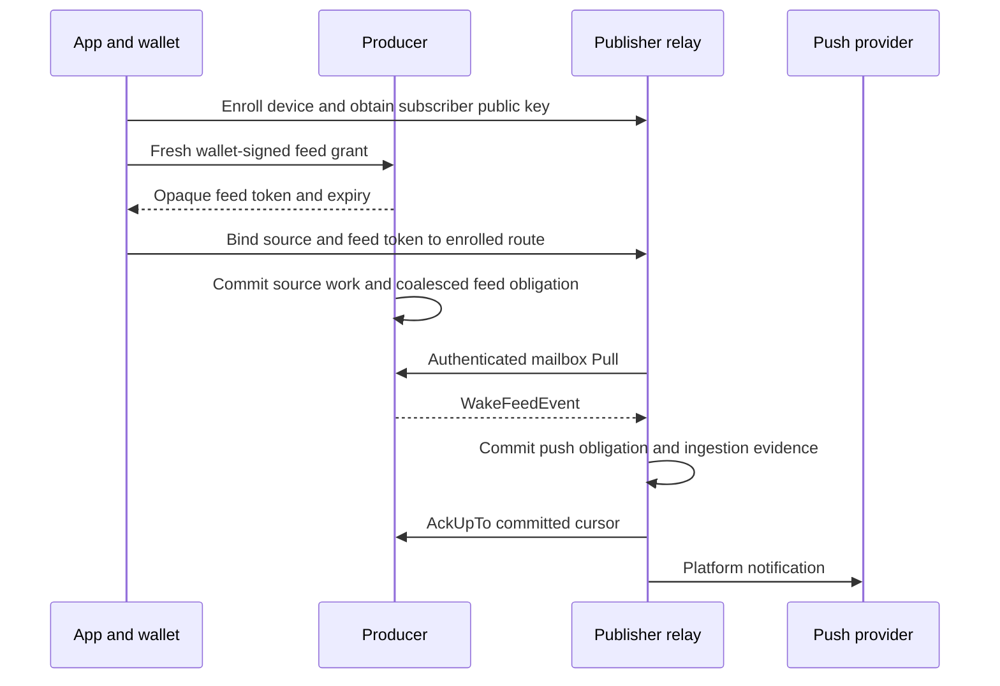

# Publisher wake feeds

A publisher runs a relay for its own app. Wallets authorize that relay's
subscriber key to observe wake hints. The producer appends hints to the
subscriber's mailbox, and the relay consumes them with `Pull` and `AckUpTo`.
The producer needs no publisher URL or platform delivery credential.

## Grant authority

`mailbox.v1.WakeFeedService` is a direct control service, independent of the
wallet's mailbox ingress. `GetFeedChallenge` returns the existing stateless
`NotificationChallenge` format. The client must match its owner and pinned
producer identities before signing. `SetFeedGrant` accepts `FeedGrantRequest`.
The producer verifies its challenge MAC and the owner's signature, then consumes
the challenge and applies the exact mutation in one database transaction.

An upsert contains:

- a publisher-issued stable `grant_id`: at least 128 cryptographically random
  bits encoded as canonical raw URL-base64, at most 64 characters. These IDs
  share an owner namespace across publishers; never use sequential IDs or
  app-local route names;
- the subscriber's canonical 33-byte compressed secp256k1 public key;
- an `event_classes` mask: 1 for protocol work, 2 for classified incoming
  payment activity, or 3 for both;
- an expiry no more than 30 days after producer verification;
- subscriber-signed route consent for this exact producer, grant ID, class
  mask and expiry. The relay issues consent after its own device admission.

The producer retains one owner for each (subscriber, grant ID) until expiry.
A relay chooses its route IDs; its signature admits only routes it created.
This prevents arbitrary wallets from exhausting another publisher's subscriber
quota, and prevents one consent from being registered under many wallet keys.
The subscriber signs no wallet identity and the producer contacts no relay.

The grant ID is scoped to the owner. Retrying an ambiguous response uses a
fresh challenge and the same grant ID. Renewal retains the subscriber route
and correlation token; changing subscribers requires a new grant ID. Removing
a grant signs its action and
ID with the other mutation fields empty. Removal returns no token and zero
expiry. Producers may shorten a grant's expiry, never extend it.

The returned 32-byte token identifies the binding without revealing the wallet
identity to the relay. It is not a bearer credential: only the subscriber's
mailbox key authorizes reading or acknowledging events. The mailbox ID is the lowercase hexadecimal subscriber key followed by
`:wake-feed`. This reserved namespace separates feed traffic from wallet and
per-payment mailboxes. Network `Send` must not admit writes to this namespace;
only internal source transactions append events. The event envelope and
its metadata must not disclose the wallet owner. The relay authenticates each
producer against a publisher-configured source identity; a push payload cannot
select a producer connection. Wallet secrets stay in the wallet.

## Signed transcript

The BIP-340 tag is `wavelength-wake-feed-grant-v1`. Sign the following fields
in order. Byte/string fields use a uint32 big-endian byte-length prefix.
Integers use big-endian fixed-width encoding.

| Field | Encoding |
| --- | --- |
| Challenge owner public key | bytes |
| Challenge producer public key | bytes |
| Challenge expiry | int64 |
| Challenge token, including MAC | bytes |
| Mutation action | uint32 |
| Grant ID | UTF-8 bytes |
| Subscriber public key | bytes |
| Event classes | uint32 |
| Grant expiry | int64 |
| Subscriber consent signature | bytes |

Subscriber consent uses the separate tag `wavelength-wake-feed-route-v1`.
Its transcript contains producer public key, exact compressed subscriber key
and grant ID as length-prefixed
bytes, followed by class mask (uint32) and expiry (int64), all big-endian. The
subscriber signs this digest with its mailbox key; the wallet then signs the
full grant including that signature.

The wallet signature itself is excluded. Unknown fields, unknown class bits,
noncanonical keys and contradictory removal fields are rejected. The tag
separates feed authority from the existing push-subscription and mailbox-auth
signatures. `notification.SetFeedGrant` implements the challenge/sign/mutate
exchange without a running ingress loop. An unsupported service returns
`notification.ErrUnsupported`.

## Wake events and coalescing

A producer-originated `KIND_EVENT` contains `WakeFeedEvent`, with the feed
token, publisher route ID, positive generation, class mask, latest opaque payment event identity
when the payment bit is set, and grant expiry. The payment identity retains
the existing lowercase 32-byte hexadecimal correlation format. A wake-only
hint carries no payment identity. The event proves no received amount or
completed payment; apps reconcile their authoritative wallet state.

Each grant has at most one outstanding envelope. Source work advances the
pending generation and accumulates class bits. It preserves the latest payment
identity even when later protocol-only work arrives. An outstanding envelope
is immutable. Acknowledging it clears its outstanding marker and, when a newer
generation exists, appends its successor in the same transaction. A source
commit racing an ACK therefore either appears in that successor or creates a
new outstanding envelope itself. Subscriber mailbox appends never create wakes.

These are coalesced doorbells, not a complete payment log. Several payment
events may yield the latest correlator only, as with a coalesced push job.
Clients must reconcile durable receipt sources rather than count hints as
payments. Ordinary indexer/round-confirmation sources can create feed work
even when there is no wallet mailbox envelope.

An app binds a token through authenticated relay management. The relay must
also match the event's publisher route ID to that enrolled route. Token
knowledge alone must not let another installation retarget a hint.

The relay must durably record its push obligation and ingestion identity before
acknowledging the cumulative cursor. A crash before ACK replays the same event
without creating another obligation. An ACK does not wait for provider
acceptance. Provider acceptance still proves neither phone delivery nor wallet
completion. Multiple relay instances must coordinate source cursor ownership
or acknowledge only a prefix whose ingestion is durably committed.

## Admission and implementation boundaries

Admission is self-service under owner, subscriber and global storage budgets.
A publisher URL allowlist is not part of the protocol. Resource limits must
bound revoked/expired retained evidence as well as active grants; bounded
cleanup must retain replay evidence for its documented window. Paid admission
can be added independently.

This contract PR adds wire types and signing/client helpers. It does not yet
implement producer persistence, subscriber ingress, relay token binding or a
public SDK/mobile entrypoint. Those are separate implementation slices. The
existing HTTP push service is unchanged by this slice. The complete feed stack
uses an explicit coordinated cutover with fresh enrollment; it requires no
legacy relay-store importer or dual-delivery transition layer.

The feed does not change durable wallet execution, verified receipt presentation,
notification consent or authenticated tap routing. A separate `ProcessNext`
API must prove its own persistence and lifecycle guarantees. Transport ACK is
not an idle, shutdown or payment-completion barrier.
