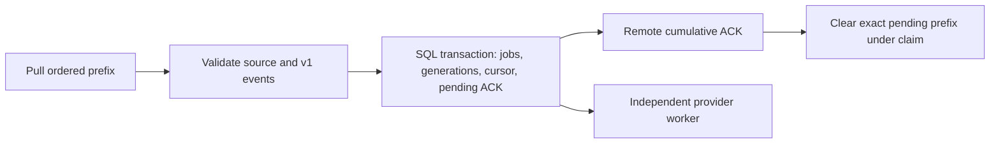

# Notification relay SQL storage

The publisher relay has its own database. `notifyrelay/relaydb` opens SQLite or
PostgreSQL and applies the same embedded migrations to either engine. It owns
installation assertions, consumed challenges, subscriptions, source subscriber
keys, feed checkpoints and provider jobs. It contains no wallet state or wallet
signing keys.

The reference daemon uses this SQL store and fixed-source subscribers. It
opens no legacy store and exposes no producer push endpoint. Old library
regression fixtures remain only until their separate cleanup slice.

## Persistence rules

- SQLite uses a publisher-configured private file, WAL and synchronous commits.
  Its pool has one connection. PostgreSQL uses a dedicated publisher database.
- A source has its own persisted subscriber key. Never reuse that key at an
  unrelated producer: the existing mailbox authentication proof is not bound to
  a producer identity.
- Consumed challenges and installation assertion counters commit with their
  authorized state change. Token revisions cannot decrease. A subscription ID
  cannot change its installation or app route.
- `Database.Write` uses a serializable transaction and retries recognized engine
  conflicts. Its closure contains SQL and local computation only. Reset outputs
  on each attempt. Provider sends and remote mailbox ACKs run after commit.
- Source identity and challenge keys use insert-if-absent queries. Restart must
  restore them rather than regenerate authority over enrolled routes.

## Generation and verification

Run `make relay-sqlc` after changing `notifyrelay/relaydb/queries` or migrations.
The pinned generator produces `notifyrelay/relaydb/sqlc`; do not edit that Go
code. Handwritten Go contains no SQL statements.

`go test -race ./notifyrelay/relaydb/...` exercises SQLite. Add
`-tags=test_postgres` to run the same cases on a disposable PostgreSQL container.
The suite covers pool restart, binary round trips, challenge rollback, concurrent
counter updates, stale token/counter rejection, subscription ownership and source
key retention.

## Provider job ownership

Each provider job has a claim token and lease. An installation also has a
delivery lease shared by all its routes. That second lease prevents two replicas
from claiming different routes on one device before the first result records
its quiet period. Provider I/O stays outside both SQL transactions.

Completion fences both claims. It marks only the sent generation done; newer
work stays pending. Accepted sends update the installation's scope-specific
quiet period. A stale result cannot release a newer device lease or disable a
rotated token. Invalid destinations retain a bounded obligation for signed token
recovery instead of blocking an aggregated source's cumulative ACK.

Payment correlators retain bounded replay evidence across presentation changes.
Ordinary wake ingestion uses its durable checkpoint and grant generation rather
than allocating a long-lived dedup row for every wake. Indexed cleanup removes
expired jobs, replay records and subscriptions in bounded transactions.

The job race tests use separate database pools for competing workers and lease
takeover. They also cover N+1 during N's send, quiet periods across routes, token
rotation/recovery, presentation cutover, transaction rollback, replay quota
isolation and independent expiry horizons. The subscriber and HTTP runtime use the same job boundary.

## Publisher source offers and bindings

The publisher configures each producer's fixed endpoint, identity, optional TLS
certificate and ordinary RPC macaroon. HTTP requests cannot choose those values.
The relay persists a distinct subscriber key for each producer. Reusing a source
ID with another producer identity fails instead of transferring that authority.

1. Device enrollment and signed subscription management create an opaque random
   relay subscription ID. The app-local route remains local.
2. The relay returns one consent offer per configured source. Each signature
   binds the producer identity, subscriber key, subscription ID, allowed event
   classes and expiry. New offers for alert-disabled subscriptions contain no payment consent.
   Existing producer delegation changes require a new wallet signature.
3. The app asks its wallet SDK to authorize that exact offer at its configured
   source. The source returns an opaque feed token.
4. Signed `bind_feed` management attaches the token to that device's existing
   subscription and configured source. It cannot claim another device's route.

Tokens are correlation, not authorization. They need not be globally unique.
Ingress first looks up the event's grant ID as a local subscription. The
following subscriber slice handles producer events that race the app handoff. Rebinding the same token retains generation progress;
rotating the token starts a new generation stream. Revocation deletes local
feed bindings with their subscription. The SQL runtime owns the subscriber workers and authenticated HTTP API.

## Subscriber ingress and acknowledgement

`NewFeedSubscriber` opens the configured TLS producer endpoint with its ordinary
RPC credentials. A direct feed challenge checks the configured logical source
identity before the relay sends its static subscriber proof. The identity is
supplied by the authenticated TLS endpoint; the challenge is not a new
server-signature scheme. Pull and ACK then carry the source-specific R proof.

Each bounded `Step` acquires a SQL lease for that source. It flushes a retained
ACK before pulling, even when no envelopes remain. Otherwise the producer could
keep an outstanding marker and never emit a pending successor.

Jobs, binding generation and checkpoint commit atomically. Global pending-job exhaustion
rolls them all back and sends no ACK. An ambiguous ACK response retains pending
state. Restart retries that ACK before another Pull. Stale lease owners cannot
write jobs, advance the checkpoint or clear a newer owner's pending ACK.
Provider acceptance is independent of the source ACK and proves no device
execution or wallet completion.

The fixed producer's ordered event stream is authoritative for its correlation
token. A wake can beat the app's `bind_feed` response, including after token
renewal. Ingress first resolves the event's random grant ID to an **existing**
local subscription. It can learn or refresh that route's token under current
publisher class policy, alert consent and the shorter source/local expiry.
Tokens never allocate subscriptions or choose a device. A delayed app handoff
of the same token retains generation progress. Same-token generations and the
source cursor suppress replay. Unknown or revoked routes are skipped under a
committed checkpoint. Disabled device tokens still get bounded local jobs and
wait for signed token recovery without blocking other routes.

A malformed envelope, unsupported version, unexpected source/recipient or wrong
RPC method stops the source prefix without ACK. This is a producer compatibility
or correctness fault, not a device-controlled routing mechanism. Legal sequence
gaps after expiry/revocation are accepted. Empty responses alone never advance
a checkpoint.

The daemon owns the stepping loop. It cancels and joins each subscriber before
closing connections and SQL. A cancelled step leaves at most a bounded lease;
no detached cleanup outlives it. The command owns that cancellation and shutdown boundary.

## Publisher authentication and provider modules

`Config.Authenticator` selects trusted publisher code implementing
`DeviceAuthenticator`. App Attest is the default. It keeps Apple's dedicated
attestation root, audience, environment, nonce, key and exact-payload checks.
There is no HTTP or CLI switch that disables authentication.

The module validates local application policy and authenticates enrollment and
management transcripts with the request context. It returns public verification
material and an authenticated assertion counter. SQL independently owns consumed
challenges, strictly increasing counters, installation ownership and token
revisions. Modules must bind the canonical 32-byte base64 credential identifier
to their authenticated credential. Its encoding is not an Apple trust claim.
Publisher account implementations retain private account credentials outside
relay installation records.

The delivery `Provider` separately validates application destination policy and
normalizes device tokens. APNs requires valid hex and canonicalizes lowercase.
An opaque provider can preserve case-sensitive tokens. Custom publishers must
implement these provider methods; implementing `Send` alone is insufficient.
`AppConfig`'s Apple fields are required only by the reference Apple modules.
Other modules validate their own audience/destination policy using their local
configuration. Changing authentication policy requires deliberate enrollment;
no evidence importer or automatic trust fallback is provided.

The HTTP integration tests include a signed account fixture with no Apple
configuration and a case-sensitive opaque provider. They check credential and
payload substitution, enrollment replay, store-owned monotonic counters and
rotation without case changes. This proves the extension boundary, not a
shipped Android or account-authentication product.

## Replay capacity isolation

A device's payment replay quota must not block an aggregated source prefix.
If its replay budget is full, ingestion still commits one bounded local payment
candidate in the existing job queue. It advances the source checkpoint with
that job, so other devices keep moving. Global pending-job exhaustion remains
real backpressure and rolls back the whole source prefix.

A payment candidate cannot reach the provider until the claim transaction
reserves its 24-hour replay record. If capacity remains full, the worker delays
only that unclaimed job for one minute and considers other routes. Existing
live replay evidence belongs to that pending job/retry: enqueue never creates
a job for an identity already admitted by an older job. The unique route/scope
job and transaction boundary make an additional replay-state flag unnecessary.

This preserves replay evidence for admitted identities and presentation changes.
A deferred candidate has not yet been admitted for presentation. It still has
the ordinary one-hour/grant expiry and can expire without a banner; it never
becomes an unbounded second queue. Coalescing keeps only the latest candidate.
Signed presentation changes drop pending jobs under the existing transaction.
Protocol wakes retain their separate budget. No device can turn its own replay
quota into head-of-line blocking for every device on the subscriber mailbox.
