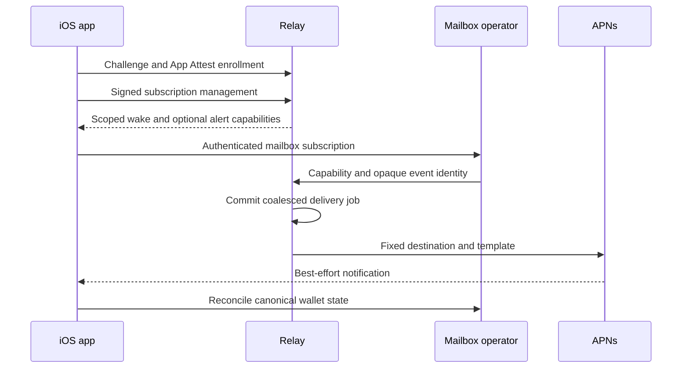

# Notification relay

`wavenotifyd` sends fixed notifications for a publisher's own iOS app. The
publisher configures Apple App Attest and Apple Push Notification service
(APNs) credentials. An app installation proves possession of its attested key
before registering a device token or changing a subscription. A mailbox
operator receives revocable capabilities for a fixed subscription, rather
than device tokens or Apple credentials.



The relay never receives wallet seeds, mailbox contents, payment amounts or
arbitrary callback URLs. A remote generic alert says to open the wallet. The
app may display a verified amount after reconciling persisted wallet activity.
APNs acceptance proves neither device delivery nor wallet completion. Wallet
safety and foreground recovery must work when no background notification runs.

## Publisher configuration

Provide a JSON array of policies through `--apps-config`. Example identifiers
below are placeholders. The App ID prefix must be the actual Apple App ID
prefix, which can differ from a publisher's Team ID.

```json
[
  {
    "id": "wallet-production",
    "apple_app_id": "TESTTEAM01.com.example.wallet",
    "topic": "com.example.wallet",
    "attest_environment": "production",
    "apns_environment": "production"
  }
]
```

Use separate aliases for development and production. TestFlight uses production
APNs independently of the wallet's Bitcoin network. Once enrolled, an
installation retains its exact policy. Changing the same alias to a different
topic, audience or environment fails closed for existing installations.

Mount the Apple PKCS#8 P-256 provider key in a private file. Do not put the
key or device tokens in flags, request logs, crash reports or metrics. The
provider key ID and Team ID identify that credential; they do not select an
HTTP caller's application. The trust root for App Attest is embedded from
Apple's dedicated App Attestation certificate authority.

```sh
go build -o /tmp/wavenotifyd ./cmd/wavenotifyd
/tmp/wavenotifyd --apps-config=/config/apps.json \
  --apns-key-file=/secrets/provider.p8 --apns-key-id=TESTKEY001 \
  --apns-team-id=TESTTEAM01 --database=/data/relay.db \
  --listen=127.0.0.1:8080
```

The default listener accepts loopback only. A non-loopback listener requires
`--behind-tls-proxy` and a trusted HTTPS ingress. Keep `/metrics`, `/healthz`
and `/readyz` on a private monitoring path. Apply ingress request and connection
limits as well as the relay's 64 concurrent-handler limit and 64 KiB body
limit. There is no attestation bypass or unauthenticated enrollment mode.

## App protocol

All paths use JSON. Bytes in JSON use standard padded base64. Unknown fields
and trailing JSON values are rejected. Enrollment returns 201; management 200;
accepted notifications return 202. Errors contain a fixed `error` code and
never echo proofs, capabilities or device tokens.

1. `POST /v1/challenges` with `app_id` and `operation: "enroll"` obtains a
   five-minute challenge. Management uses `operation: "manage"` and the
   existing `installation_id`.
2. Build the exact payload bytes once. Enrollment payload is
   `{"device_token":"hex-encoded-APNs-token"}`. Calculate the transcript below,
   then pass SHA256(transcript) to Apple's `attestKey` or `generateAssertion`.
3. `POST /v1/installations` with `challenge_id`, `key_id`, `proof` and `payload`
   enrolls. `proof` is Apple's attestation object; `payload` is the base64
   representation of the original JSON bytes. Store the returned
   `installation_id` with the App Attest key identifier.
4. `POST /v1/installations/{installation_id}/manage` carries the same proof
   envelope with an assertion and no `key_id`. Serialize assertions per key
   so their strictly increasing counters commit in generation order.

The transcript is UTF-8 ASCII fields separated by literal newline bytes,
including the **final newline**. An empty installation ID occupies an empty
line during enrollment. The digest is lowercase hexadecimal SHA256 of the
exact payload bytes, without parsing or re-encoding JSON.

```text
wavelength.notification-relay.v1
<operation>
<app_id>
<installation_id or empty>
<challenge id>
<challenge nonce>
<payload digest>
```

The challenge is authenticated by the relay and bound to the operation, app
and installation. Anonymous challenge creation allocates no database record.
Only a verified proof consumes a challenge, atomically with its assertion
counter and mutation. Reusing either a consumed challenge or an old counter
is rejected. A retry after an ambiguous response needs a new challenge and
assertion. Subscribing to the same route rotates its capabilities; deliver the
new capabilities to the operator before considering renewal complete.

Enrollment's installation ID is the lowercase hexadecimal SHA256 of
`app_id + NUL + decoded App Attest key_id`. The decoded key ID is 32 bytes.
This permits signed management recovery when enrollment committed but its
response was lost. Re-enrollment never resets an existing assertion counter.

Management payload actions are:

| Action | Additional fields | Result |
|---|---|---|
| `rotate_token` | `device_token` | Replace token and increment its revision |
| `subscribe` | `route_id`, `enable_alerts`, optional `alert_presentation` | Create/renew a 30-day subscription and rotate scoped capabilities |
| `revoke_subscription` | `subscription_id` | Revoke only this installation's subscription |
| `delete_installation` | none | Disable delivery and erase token, key and attestation receipt |

Route IDs are app-owned opaque wallet/network lookup identities. They confer
no wallet authority. Keep route mapping local and validate the selected account
and network after a tap. Each installation allows at most 16 live routes.
Capabilities are 32 random bytes. The relay persists only their SHA256 hashes.
Wake and alert scopes are separate; disabling alerts also drops queued alerts.

## Operator protocol

Before persisting a mailbox notification subscription, its producer verifies
that the app actually holds grants issued by the configured relay. After
checking the mailbox owner's fresh full-request signature, call
`POST /v1/subscriptions/verify` at the configured HTTPS origin, with
`Authorization: Bearer <wake capability>` and:

```json
{"subscription_id":"relay-issued-id","alert_capability":"optional-alert-grant"}
```

HTTP 200 returns only `expires_at`, the live subscription's Unix expiry. The
wake grant must authorize that subscription. An optional alert grant must have
alert scope for the same subscription. Expired, revoked, deleted, mixed or
unsupported-policy grants fail with HTTP 401. A valid grant whose current
APNs token was invalidated returns HTTP 503 instead, on both verification and
push admission. Producers must retain the binding and use their bounded retry
policy; signed token rotation restores delivery with the same grant. No job
is admitted while the destination is disabled. This read-only call creates no
job and sends no push. The producer must cap its saved expiry to this verified grant and
consume the signed request's nonce atomically with its local mutation. Perform
the verification call outside the database transaction. Resolve the HTTPS
origin through a server-configured relay allowlist and deny redirects; a client
must not choose a URL. A mailbox signature alone proves no relay enrollment.

Call `POST /v1/wakes` or `POST /v1/alerts` with
`Authorization: Bearer <matching capability>` and `{"event_id":"opaque-id"}`.
The capability fixes installation, route, app policy, expiry and scope. The
request cannot choose another destination or notification text. The producer
must use a stable event identity when retrying an ambiguous response. Visible
alerts require an authorized incoming-payment event at the producer; arbitrary
mailbox traffic does not establish that a payment occurred.

Repeated identities deduplicate for 24 hours. Pending work coalesces per scope
and subscription. Jobs expire after an hour. Global budgets bound queued jobs
to 4096, dedup records to 100000 and consumed challenges to 100000. Per-route
dedup capacity is 1024. Capacity returns 429; callers retain their durable job
and retry. A single installed device observes a 20-minute quiet period after
an accepted silent push and a separate one-minute alert quiet period.

## Storage, retries and operations

Use exactly one relay process and a persistent volume for the dedicated Bolt
file. The file has mode 0600 and a five-second exclusive-open timeout. A
restart preserves subscriptions, assertion counters, challenge authentication
key, replay records, delivery identities and pending jobs. Losing this file
requires app re-enrollment. Back it up as private data with an application-
consistent snapshot. Never share a wallet database or run multiple replicas
against this file.

Delivery claims expire after 30 seconds. The worker retries temporary provider
failures with bounded backoff and stable request identity. A completion is
fenced by its claim and generation, so it cannot erase work added during the
send. APNs invalid-token responses are also fenced by the token revision and
invalidation timestamp. A late response cannot disable a newly registered
token. Transport errors are sanitized because HTTP error URLs contain tokens.

SIGTERM cancels provider I/O, stops HTTP admission, joins the worker and HTTP
handlers, then closes storage. If joining exceeds 30 seconds, the command exits
without closing storage beneath live workers; Bolt recovers at the next open.
Readiness requires a running worker. Metrics use fixed scope/outcome labels
and contain no installation, route, event, capability or token identifiers.

Build the non-root image with `Dockerfile.notifyrelay`. The existing Docker
workflow builds and publishes the relay alongside the daemon after this source
lands on main (and on its existing tag/nightly/manual triggers). Relay tags
share the source tag suffix and the binary embeds the actual checkout SHA.
No publication workflow is run as part of preparing this PR. Source publication,
registry upload, configuration activation and real-device acceptance are
separate steps. This change creates no credential, sends no live notification
and activates no service.

Run `go test -race ./notifyrelay ./cmd/wavenotifyd -count=1` for the local
authentication, queue, provider and shutdown suite. Enrollment tests replace
Apple certificate issuance; management tests use real P-256 App Attest
assertions. Provider transports are faked. Apple's validation-guide vectors
can also be checked with
`go test github.com/takimoto3/app-attest -run 'Test.*Golden|TestApple'`.

The generic alert says “Payment activity. Open Wavelength to update your wallet.”
A source may signal an incoming HTLC before the phone has completed its claim.
The fixed template therefore does not claim a completed receipt or an amount.

## Verified receipt presentation

An updated app may sign a subscription with `enable_alerts: true` and
`alert_presentation: "receipt_hint"`. The management response must explicitly
acknowledge `alert_presentation: "receipt_hint"` before the app enables this
mode. Omission or `"generic"` preserves the visible template for older apps.
Other presentation values, a presentation without alert consent, and a
presentation on unrelated management actions are rejected.

A payment producer still calls `/v1/alerts` with its existing scoped grant.
The relay sends `content-available: 1`, no `aps.alert`, APNs push type
`background`, and the fixed app-data marker `kind: "payment_activity"`.
The existing `event_id` is the SHA256 of the producer's opaque event identity.
An ordinary `/v1/wakes` request never carries this marker. Both payment modes
share the one-minute payment budget; ordinary wakes retain their separate
20-minute budget. Apple's delivery policy may throttle or omit background
hints, even when the relay accepts them.

The marker authorizes a payment-activity fallback. It proves no amount or
completion. For an amount, the app must match the event to an invoice enrolled
under current consent and verify completed native wallet state. A locked,
interrupted or unmatched path may use the fixed generic local alert. Persist
presentation deduplication before adding a local notification. A process crash
can omit an alert; activity and wallet recovery remain authoritative.

A signed mode change permanently drops pending payment events atomically
with capability rotation, retaining replay evidence. Retrying a dropped event
returns accepted without recreating its job. An interrupted old send that
needs retry is dropped too. The app performs foreground reconciliation during
this cutover; old activity is not presented again in the new mode. An old in-flight provider completion
cannot erase a newly queued event. APNs may already hold an older visible
alert when the change commits; it cannot be recalled. The app must treat a
remote visible alert as already presented.

Opening an existing format-one database upgrades its format marker to two
without deleting records. Missing presentation fields mean generic. Format-one
binaries reject the new marker, so rollback requires a format-two compatible
binary. Back up the volume before upgrading. No command in this change starts
a relay or changes an app's subscription.

### Invoice correlation contract

An enrolled-invoice producer may use lowercase hexadecimal SHA256 of these
concatenated bytes as its opaque EventID: ASCII
`wavelength.receipt-notification.v1`, one zero byte, the wallet owner's
33-byte compressed public key, and the invoice's 32-byte payment hash. The
relay performs its existing SHA256 over the UTF-8 EventID and sends that
second digest as `wavelength.event_id`. The relay does not receive the inputs.
Knowing a public invoice does not grant push authority; capability checks and
the producer's incoming-payment classification are still required.

Cross-language fixture (public synthetic inputs):

```text
owner: 0279be667ef9dcbbac55a06295ce870b07029bfcdb2dce28d959f2815b16f81798
payment_hash: 000102030405060708090a0b0c0d0e0f101112131415161718191a1b1c1d1e1f
event_id: 421275775f70409fe668dbda0cb19464c1f90d1560132437ceafbfed6f091aee
wavelength.event_id: aea16881a4d03ec94406d8539aee80b8027806ef6ba01df56d77143eb8118f78
```
