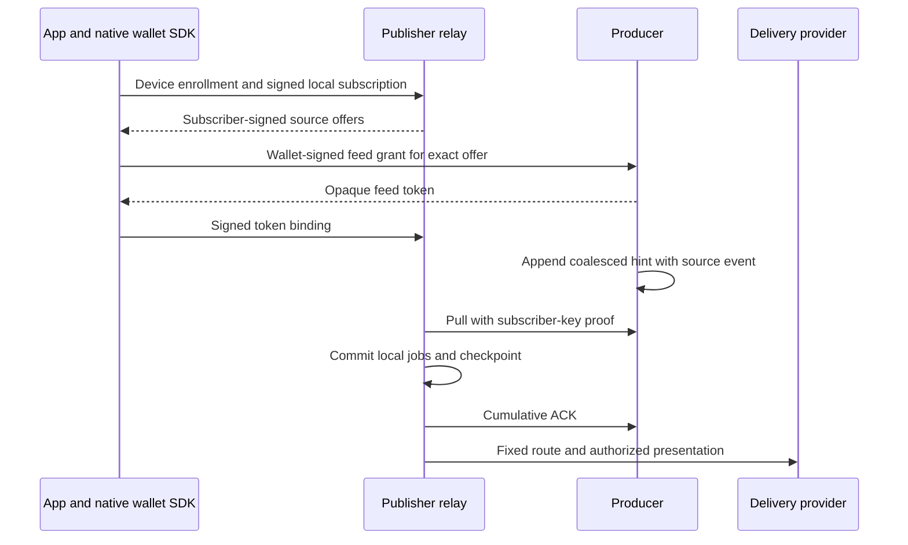

# Notification relay

`wavenotifyd` is a publisher-owned subscriber and delivery service. Producers
append generic wake hints to its mailbox. The relay consumes those hints and
owns device enrollment, delivery providers, quiet periods and presentation.
Another app team can run its own relay without a producer relay-URL allowlist.
The reference uses App Attest and Apple Push Notification service (APNs).



A hint contains no wallet identity, amount, device token or callback URL. The
relay holds its subscriber keys, device destinations and public enrollment
evidence; it never holds wallet signing keys. Provider acceptance proves
neither device execution nor wallet completion. Foreground wallet recovery must
work when background notification delivery never runs.

## Publisher configuration

Build the reference command with `go build -o /tmp/wavenotifyd ./cmd/wavenotifyd`.
Provide an `--apps-config` JSON array. All identifiers below are placeholders.
The Apple App ID prefix can differ from the publisher's Team ID.

```json
[
  {
    "id": "wallet-production",
    "apple_app_id": "TESTTEAM01.com.example.wallet",
    "topic": "com.example.wallet",
    "attest_environment": "production",
    "apns_environment": "production"
  }
]
```

Use separate aliases for development and production. TestFlight uses production
APNs independently of the wallet's Bitcoin network. Enrollment retains the
exact app policy. Changing its audience, topic or environment requires deliberate
re-enrollment; an existing installation does not silently change policy.

Provide `--sources-config` as a JSON array of fixed producer endpoints and
identities. This example public key is synthetic, not a real service identity.
Use the producer's normal RPC admission credentials. A feed grant does not
bypass those credentials or the wallet owner's ordinary admission policy.

```json
[
  {
    "id": "primary",
    "role": "operator",
    "endpoint": "producer.example:443",
    "public_key": "0279be667ef9dcbbac55a06295ce870b07029bfcdb2dce28d959f2815b16f81798",
    "tls_cert_file": "/config/producer-root.pem",
    "macaroon_file": "/secrets/client.macaroon",
    "event_classes": 1
  }
]
```

`tls_cert_file` may be omitted for system TLS roots. `macaroon_file` may be
omitted only when that producer's ordinary RPC policy permits it. Bit 0 of
`event_classes` permits protocol wakes; bit 1 permits classified payment hints.
Unknown bits fail startup. A role is a local app-facing label, not authority.
No HTTP caller chooses an endpoint, credential path or source identity.

The relay persists a distinct subscriber key per configured source. Reusing a
source ID for another producer identity fails. Never reuse a subscriber key
across unrelated producers: the existing static mailbox proof is not bound to
a producer identity. The TLS endpoint supplies the checked logical source
identity; the feed probe is not a new server-signature scheme.

Mount the Apple PKCS#8 P-256 provider key privately. Do not put provider keys,
PostgreSQL DSNs or device tokens in command-line arguments, logs or metrics.
The App Attest module embeds Apple's dedicated attestation root, independently
of TLS certificate trust.

```sh
/tmp/wavenotifyd --apps-config=/config/apps.json \
  --sources-config=/config/sources.json \
  --apns-key-file=/secrets/provider.p8 --apns-key-id=TESTKEY001 \
  --apns-team-id=TESTTEAM01 --database=/data/relay-sqlite.db \
  --listen=127.0.0.1:8080
```

SQLite is the default dedicated store. `--postgres-dsn-file=/secrets/relay-dsn`
selects PostgreSQL instead; `--database` is the SQLite path only. Keep either
database separate from all wallet state. The new SQLite filename intentionally
avoids the retired store. A non-SQL file fails instead of being imported or
opened through a fallback.

The default listener permits loopback only. Non-loopback HTTP requires
`--behind-tls-proxy` and trusted HTTPS ingress. Keep `/metrics`, `/healthz` and
`/readyz` on a private monitoring path. Apply ingress connection/request limits
in addition to the command's 64 concurrent handlers and 64 KiB body limit.
There is no CLI or HTTP authentication bypass.

## Device and wallet setup

JSON byte fields use standard padded base64. Unknown fields and trailing values
are rejected. Enrollment returns 201; successful management returns 200. Public
errors never echo proofs, tokens or private records.

1. `POST /v1/challenges` with `app_id` and `operation: "enroll"` obtains a
   five-minute stateless challenge. Management uses `operation: "manage"` and
   the existing `installation_id`.
2. Serialize exact payload bytes once. Enrollment uses
   `{"device_token":"hex-encoded-APNs-token"}` with the reference provider.
   Pass SHA256 of the transcript below to Apple's attestation/assertion API.
3. `POST /v1/installations` carries `challenge_id`, `key_id`, `proof` and
   `payload`. Save the returned installation ID with the attested key ID.
4. `POST /v1/installations/{installation_id}/manage` carries an assertion over
   the exact payload and no `key_id`. Serialize assertions per credential.
5. A signed `subscribe` returns a random local subscription ID and source
   offers. Ask the native wallet's `SetNotificationFeedGrant` to authorize each
   exact offer at its already configured source. Neither a push nor an offer
   may introduce a caller-selected producer endpoint.
6. Return the source token through signed `bind_feed` management. Feed tokens
   use canonical raw URL-base64, unlike the proof envelope's padded base64.

The transcript is UTF-8 ASCII fields separated by literal newline bytes,
including the **final newline**. An empty installation ID occupies an empty
line during enrollment. The digest is lowercase hexadecimal SHA256 of the
exact payload bytes, without parsing or re-encoding JSON.

```text
wavelength.notification-relay.v1
<operation>
<app_id>
<installation_id or empty>
<challenge id>
<challenge nonce>
<payload digest>
```

The relay consumes the challenge with its counter and authorized mutation in
one transaction. Replay returns 409. An ambiguous response needs a fresh
challenge and assertion. Enrollment never resets an existing counter.

Installation IDs are lowercase SHA256 hex over
`app_id + NUL + decoded credential key_id`. The decoded credential identifier
is 32 bytes. App Attest binds it to its attested key. A custom publisher module
must bind it to that module's authenticated credential.

| Action | Additional fields | Result |
| --- | --- | --- |
| `rotate_token` | `device_token` | Validate/normalize destination and increment token revision |
| `subscribe` | `route_id`, `enable_alerts`, optional `alert_presentation` | Create/renew a route for slightly less than 30 days and return source offers |
| `bind_feed` | `subscription_id`, `feed_binding` | Bind configured source/token/classes/expiry to an owned route |
| `revoke_subscription` | `subscription_id` | Remove this installation's route and bindings |
| `delete_installation` | none | Disable delivery and erase destination/public credential evidence |

`feed_binding` contains `source_id`, `feed_token`, `event_classes` and
`expires_at_unix`. A device cannot claim another installation's subscription.
Each installation has at most 16 live routes. Route IDs are app-owned wallet/
network lookup labels, not wallet authority. Validate that local mapping and
the selected account/network after a tap.

The subscriber-signed offer binds producer identity, subscriber key, random
subscription ID, classes and expiry. The wallet signs the full source grant.
Only the source learns that wallet identity. Tokens never authorize a mailbox
read, allocate a route or choose a destination.

A source event may arrive before the app returns its token, including renewal.
The authenticated ordered source stream can learn or refresh correlation only
for an existing local random route, under current publisher class/alert policy
and the shorter source/local expiry. This retains the first wake without
blocking all other routes on unfinished app setup. Same-token renewal retains
its generation watermark. Unknown or revoked routes can be skipped safely.

## Source ACK and delivery

The producer appends one outstanding envelope per live grant. New activity
increments pending generation while that envelope remains outstanding. Its
mailbox ACK and any pending successor append are atomic. Feed mailbox appends
never create another wake; response envelopes do not cause wake loops.

The relay leases one ingress owner per source. It commits local jobs, binding
progress and a pending-ACK checkpoint together **before** the cumulative ACK.
A lost ACK response is retried before the next Pull, including an empty Pull.
A stale owner cannot advance or clear a newer checkpoint. Malformed or
unsupported source envelopes stop progress without ACK. Legal sequence gaps
after producer expiry/revocation are accepted.

The retired `POST /v1/wakes`, `POST /v1/alerts` and
`POST /v1/subscriptions/verify` endpoints return 404. Producers hold no relay
capability and call no delivery HTTP endpoint.

Ordinary wakes use checkpoint/generation replay protection without allocating
one long-lived dedup row per wake. Admitted payment correlators retain
24-hour replay evidence. Pending jobs coalesce per route/scope and expire after at most one
hour, capped by grant expiry. Limits are 4096 pending jobs, 100000 payment
replay records, 1024 replay records per route and per installation, and 100000
consumed challenges. Expired rows count until bounded maintenance removes them.
Global pending-job exhaustion rolls back the source prefix, so the producer
retains its outstanding hint. A full payment replay budget instead defers a
bounded local candidate, leaving the aggregate source ACK and other devices
free to proceed. The provider claim transaction must reserve replay evidence
first. Deferred candidates retain the ordinary expiry and may expire without a
banner. These bounds do not replace paid/resource admission at an open producer.

A device has a 20-minute silent-wake quiet period and a separate one-minute
payment period after accepted sends. SQL job and installation leases prevent
replicas from bypassing those periods through different routes. Completion
fences claims, generations and token revisions. A late provider response cannot
disable a rotated token or erase newer work. Disabled destinations retain
bounded jobs for signed token recovery instead of blocking an aggregate feed.

## Storage and process ownership

SQLite uses a private 0600 file, WAL, synchronous commits and one connection.
For multiple replicas use a dedicated PostgreSQL database and identical
publisher policies. SQL owns cross-replica claims, assertion counters and
checkpoints; it does not depend on an exclusive process file lock. Back up the
database as private data. Losing subscriber keys changes source mailbox
identity and requires new grants; losing device evidence requires deliberate
re-enrollment. There is no legacy-store importer or automatic trust fallback.

SIGTERM cancels HTTP, source loops and provider calls, joins them, then closes
SQL. If joining exceeds the command's 30-second shutdown budget, it leaves the
database open beneath live work and exits; committed SQL evidence survives.
A cancelled source step may leave only its bounded lease. No detached cleanup
outlives the daemon-owned worker.

Readiness means the relay worker is running, not that APNs or every producer
is reachable. Internal metrics count pending jobs, source failures and provider
outcomes with bounded labels. They contain no device, route, token or proof
identifiers. A source retry log identifies only its configured local alias;
raw network/driver errors cannot expose credentials there.

## Publisher modules and validation

`Config.Authenticator` selects a trusted Go `DeviceAuthenticator`; App Attest
is the default. A custom module authenticates exact transcripts and credential
identity, while SQL independently enforces nonce and counter state. The provider
validates destination policy and owns token normalization. APNs canonicalizes
hex; an opaque provider may preserve case. The reference command ships neither
an Android nor an account-auth module. See [SQL ownership and module contracts](notification-relay-sql.md).

Run `go test -race ./notifyrelay/... ./cmd/wavenotifyd` for SQLite and add
`-tags=test_postgres` for disposable PostgreSQL fixtures. HTTP tests replace
Apple certificate issuance but use real P-256 assertion signatures. TLS source
fixtures verify ordinary RPC credentials and R proof. Provider calls are
controlled; these tests do not prove physical APNs delivery or iOS execution.
Source publication, image publication, configuration activation and device
acceptance are separate gates. Preparing this code activates no service.

## Verified receipt presentation

A device may sign `enable_alerts: true` and
`alert_presentation: "receipt_hint"`. Require that exact presentation in the
management response before enabling it. Omission or `"generic"` keeps the fixed
visible payment-activity template. Invalid presentation or missing alert consent
is rejected.

For classified payment events, receipt-hint mode sends `content-available: 1`,
no `aps.alert`, push type `background` and `kind: "payment_activity"`. Ordinary
wakes never carry that payment marker. Both payment modes share the one-minute
payment budget. Apple may throttle or omit background delivery.

A hint proves no amount or completion. The app must match an enrolled invoice
and verify completed native wallet state before displaying an amount. A locked,
interrupted or unmatched path may use the fixed generic local alert. Persist
presentation dedup before adding a local notification. Wallet recovery remains
authoritative if a process crash omits a banner.

A signed presentation change drops pending payment jobs atomically while
retaining replay evidence. Old in-flight provider completion cannot erase new
work. A previously submitted APNs alert cannot be recalled. The app must treat
a remote visible alert as already presented.

### Invoice correlation contract

An enrolled-invoice producer may use lowercase hexadecimal SHA256 of these
concatenated bytes as its opaque EventID: ASCII
`wavelength.receipt-notification.v1`, one zero byte, the wallet owner's
33-byte compressed public key, and the invoice's 32-byte payment hash. The
relay performs its existing SHA256 over the UTF-8 EventID and sends that
second digest as `wavelength.event_id`. The relay does not receive the inputs.
Knowing a public invoice does not grant push authority; wallet delegation, subscriber proof and
the producer's incoming-payment classification are still required.

Cross-language fixture (public synthetic inputs):

```text
owner: 0279be667ef9dcbbac55a06295ce870b07029bfcdb2dce28d959f2815b16f81798
payment_hash: 000102030405060708090a0b0c0d0e0f101112131415161718191a1b1c1d1e1f
event_id: 421275775f70409fe668dbda0cb19464c1f90d1560132437ceafbfed6f091aee
wavelength.event_id: aea16881a4d03ec94406d8539aee80b8027806ef6ba01df56d77143eb8118f78
```
