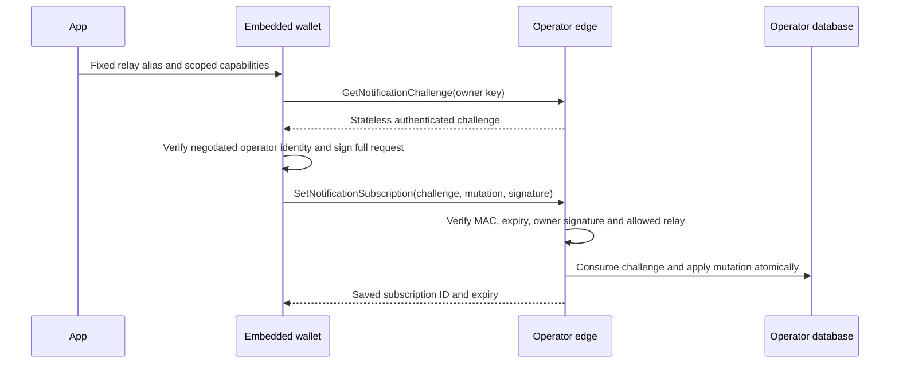

# Mailbox notification subscriptions

An app first enrolls its device token with its publisher's relay using App
Attest. The relay returns a subscription ID and separate wake/optional alert
capabilities. `wavewalletdk.Client.SetNotificationSubscription` registers those
capabilities with the wallet's operator. The app supplies a configured relay
alias, not a callback URL. The SDK signs with the wallet's mailbox identity key;
that key never leaves the wallet backend.

This change adds the direct edge `mailbox.v1.NotificationService` contract,
shared proof helpers, the embedded Go SDK method and gomobile JSON binding.
An operator must implement the persistence and delivery contract below before
notifications work. An older operator returns `notification.ErrUnsupported`;
normal mailbox operation and foreground receipt recovery remain available.



The control RPCs are direct calls on the already-negotiated operator connection.
They do not require a running mailbox ingress loop. Production uses the
operator's authenticated TLS connection. A push payload never chooses a server
connection, signing key or destination.

## Public API

`SetNotificationSubscription` accepts the following Go SDK DTO, also used as
snake-case JSON by the gomobile function of the same name:

```json
{
  "subscription_id": "relay-issued-subscription-id",
  "relay_id": "publisher-relay",
  "wake_capability": "relay-issued-wake-capability",
  "alert_capability": "optional-relay-issued-alert-capability",
  "expires_at_unix": 1794096000,
  "remove": false
}
```

The strings above illustrate field roles; they are not usable capabilities.
A real capability is exactly 32 bytes encoded as canonical raw URL-base64.
Expiry must be in the future, within the server's 30-day policy (with five minutes of relay clock tolerance),
and no later than the
relay-issued expiry. The operator can shorten its own maximum registration
lifetime. Removal uses only `subscription_id` and `remove: true`; other routing
fields must be absent/zero.

Embedded handles borrow the daemon's signer and bootstrapped operator
connection. `Connect` handles return `notification.ErrUnsupported`; this PR
adds no new remote daemon signing endpoint. The Go API takes a context. The
RPC helper caps challenge/sign/mutation work at ten seconds; gomobile derives that deadline from its wallet lifecycle. The daemon bridge
checks connection, identity and negotiated terms without waiting for ingress
readiness. Missing bootstrap state returns a wallet-not-ready error. Wallet
opening remains the host's responsibility. No locked-wallet bypass is added.

The result contains only `subscription_id` and `expires_at_unix`. A successful
removal has zero expiry. A timeout can occur after commit. Retry the same
logical mutation through a fresh invocation, which gets a new challenge and
signature. Serialize updates for one route so older renewals cannot overwrite
newer capabilities. Register renewed relay capabilities with the operator
before considering renewal complete.

## Authorization transcript

`mailbox/pb/notification.proto` defines the additive direct service and request
fields. The v1 signature is BIP-340 Schnorr under the compressed mailbox owner
key, with the exact tag `wavelength-notification-subscription-v1`. Wallet
signers receive the raw message and tag, not an already-tagged digest.

`notification.SigningMessage` checks shape and encodes fields without using
the client's wall clock. `VerifyChallenge` and `VerifyAuthorization` apply
the operator's freshness policy on the server. Fields have this fixed order:

1. Challenge owner key, operator key, challenge expiry and authenticated token.
2. Mutation action, subscription ID, relay alias, wake capability, alert
   capability and subscription expiry.

Byte/string fields use a uint32 big-endian byte length followed by their exact
bytes. Actions use uint32 big-endian. Expiries use int64 big-endian Unix
seconds. There is no JSON canonicalization or protobuf map ordering. Unknown
fields are rejected for v1, as are unknown actions, URLs, oversized identities,
noncanonical public keys/capabilities and unrelated removal fields. The
signature field itself is excluded. A static mailbox-auth signature belongs
to a different domain and cannot authorize this request.

The SDK checks that the challenge owner equals its wallet identity and that
the challenge operator equals the negotiated operator before signing. The
signature binds the capabilities and expiry as well as the destination, so a
captured ownership proof cannot authorize replacement with another route.

## Stateless challenge contract

`notification.NewChallengeAuthority` requires an operator's persistent,
cryptographically random 32-byte server secret and canonical operator key.
Create that secret once through the operator's durable store. Reopening the
store must reuse it. Do not generate a different secret on ordinary startup or
store it in a public app configuration.

A challenge expires after five minutes. Its 64-byte token is a 32-byte random
nonce followed by HMAC-SHA256 over:

- Literal `wavelength-notification-challenge-v1` plus one NUL byte.
- The 33-byte owner key, then 33-byte operator key.
- The int64 big-endian challenge expiry, then the 32-byte nonce.

`VerifyChallenge` checks the token, operator, expiry and v1 shape.
`VerifyAuthorization` separately checks the full owner signature. Neither
helper consumes a nonce. Only after both succeed may the operator enter a
write transaction and insert `ChallengeID`, SHA256 of the complete token,
into its replay table. Insert that ID and the subscription mutation in the
**same transaction**, under a unique constraint. A duplicate ID rejects the
mutation. A failed mutation rolls back nonce consumption. Retain replay rows
through challenge expiry; cleanup may remove them after expiry because the
proof is no longer valid. Anonymous challenge requests allocate no replay row.

## Operator obligations

Map the signed owner key to its canonical mailbox. Do not let a body field
select another owner's mailbox. Check `relay_id` against a configured map of
trusted HTTPS relay origins. Never accept a caller URL, follow redirects to an
untrusted host or log capabilities/proof bodies. Keep subscriptions scoped by
owner and subscription ID, with a bounded number per owner and explicit expiry.
Removal affects only that owner's subscription.

Wake delivery intent must commit with the mailbox append that requires a wake.
A process crash after append must not lose that intent. Coalesce pending work
and call the relay outside the database transaction, with stable event identity
for ambiguous retries. Revocation/expiry must fence queued work. The relay's
202 response means durable relay admission, not APNs delivery or wallet receipt.

Generic visible alerts require an authorized incoming-funds domain event at
the producer. Arbitrary protocol traffic, refresh, self-change and internal
credit funding are not proof of a received payment. An exact displayed amount
comes from canonical wallet-verified, persisted activity in the app. Foreground
recovery remains mandatory when iOS denies background execution or the wallet
cannot unlock. This control API makes no safe-to-suspend claim.
