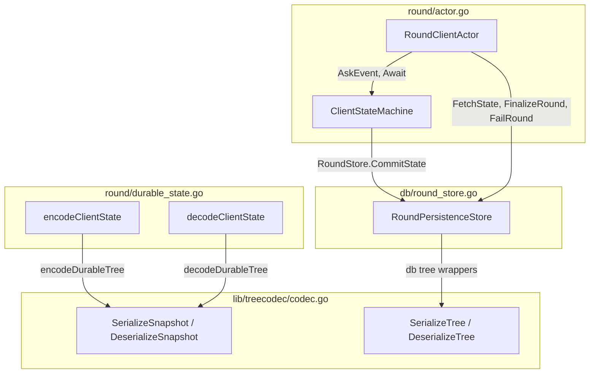
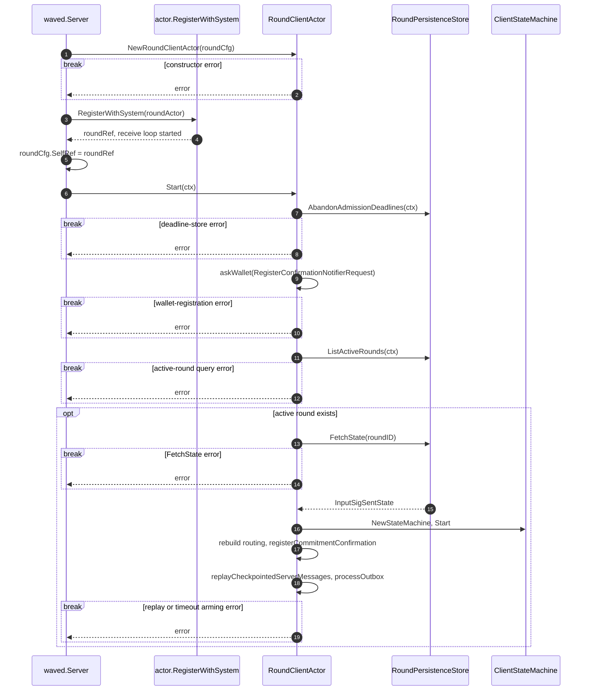
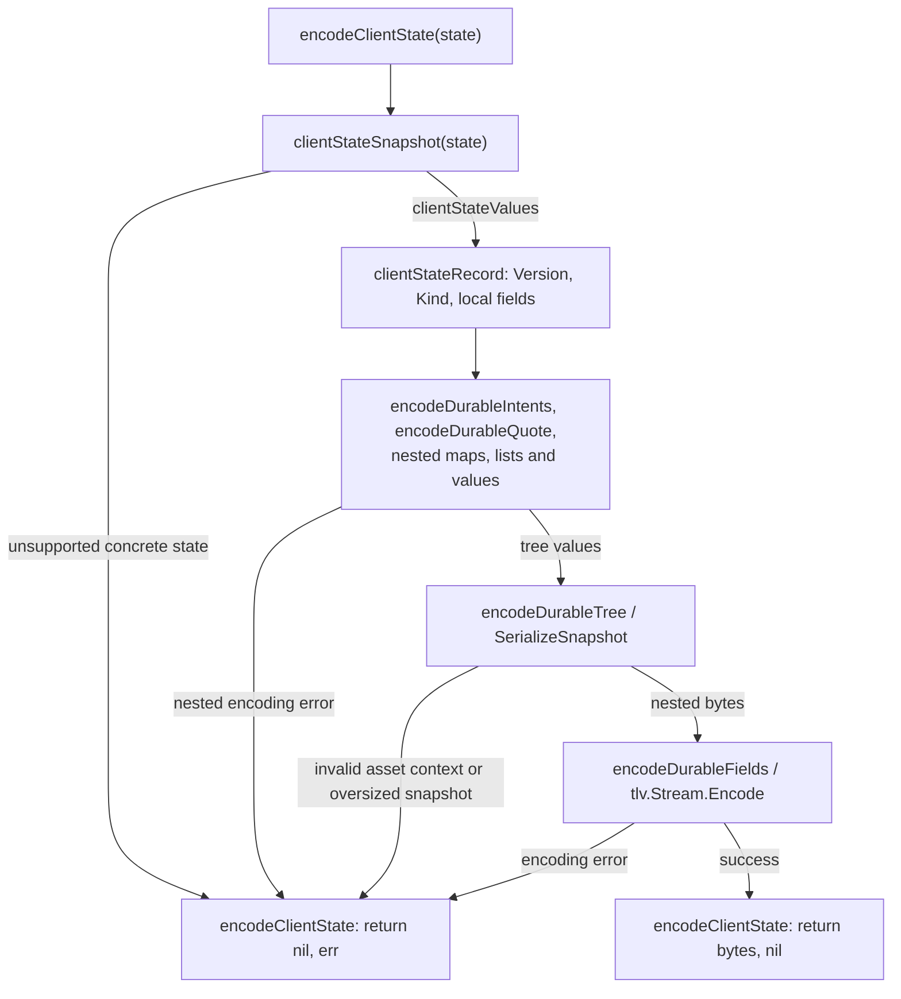
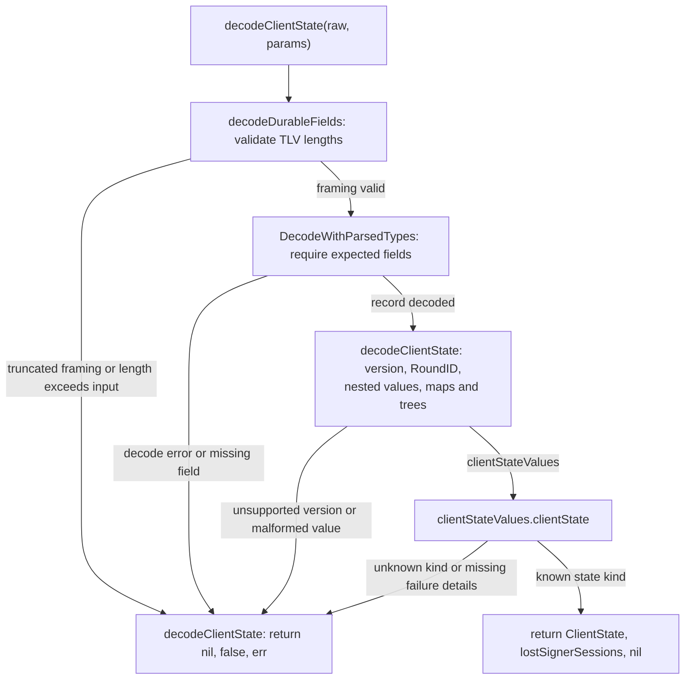
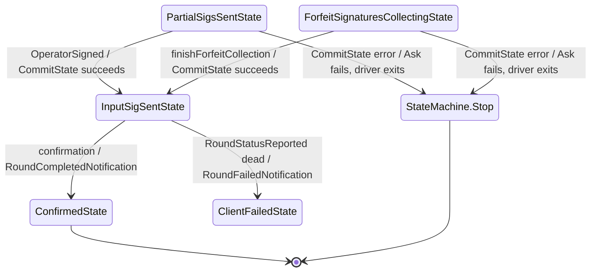
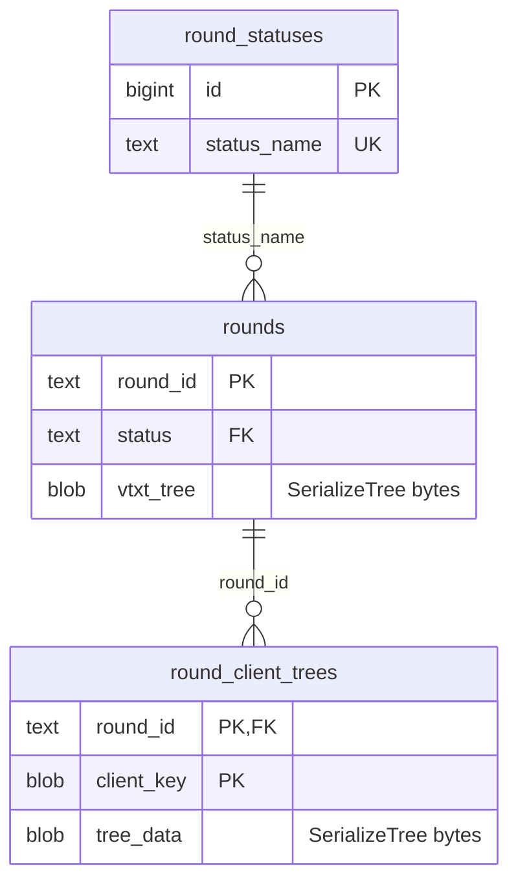

# Round Checkpoint Architecture

The round checkpoint codec preserves the local protocol state needed to
reconstruct a round without deriving it from network messages. This document
covers `round/durable_*.go`, `lib/treecodec`, and their boundary with the current
round actor and database. It reflects commit
`9430ebe6084d0cea36e7de7c73815455da2e41e6` (PR #1517). At this anchor, full-state
encoding and decoding have test callers only; production recovery uses the
existing signature-bearing database checkpoint.

See [the round protocol](../round/README.md),
[durable actor ownership](durable_actor_architecture.md), and
[the mailbox consumption plan](mailbox-consumption-plan.md) for related flows.

## Components

`round` owns the protocol representation; `lib/treecodec` owns nested tree
bytes. The database delegates its existing tree encoding to the shared codec.
The full-state codec has no call edge from the production actor at this anchor.

These are separate paths: the production signature checkpoint uses proof tree
bytes, while the full-state format uses snapshot tree bytes.

| Component | Owns | Does not own |
| --- | --- | --- |
| `RoundClientActor` | Round routing, buffered quotes, staged ledger messages and finalization retries | The per-round FSM driver or signer-private session data |
| `ClientStateMachine` | Current `ClientState` and execution of protocol transitions | A generic state/effect/inbox database transaction |
| `clientStateRecord` | Versioned fields describing a complete protocol state | Disk writes, outgoing delivery, timers or input acknowledgement |
| `clientStateValues` | The temporary projection between concrete states and record fields | The actor's routing maps or the signer's private sessions |
| `treecodec` | Tree projection, reconstruction and decode bounds | SQL transactions or fresh cryptographic/chain admission |
| `RoundPersistenceStore` | The existing relational signature checkpoint, finalization and failure writes | Persistence of every `clientStateRecord` phase |

## Startup and existing recovery

Production startup constructs an ordinary actor and reconstructs active rounds
through `RoundStore`. There is no codec startup hook.

Registration starts the receive loop before `Start` runs on the daemon startup
caller. Each fallible startup call returns immediately on error.
`Start` restores confirmation and status reconciliation from stored
`input_sig_sent` rounds. It does not call `decodeClientState`.

## Encoding a full protocol state

`encodeClientState` returns bytes without writing them anywhere. A checkpoint
version of `1` identifies the record layout; stable kind values distinguish
the concrete states independently of their display names.

The result is a representation, not a durable commit. The codec neither sends
signatures nor marks a mailbox message consumed.

1. **Project.** `clientStateSnapshot` selects the concrete state and reads its
   fields into `clientStateValues`. Capture requires stable, exclusively owned
   state; the projection is not a synchronized deep copy.
2. **Retain local facts.** Nested codecs preserve request order, accepted quote
   amounts, key descriptors, ownership, proofs and existing signing artifacts.
   They do not derive replacement values from current wallet settings.
3. **Encode collections.** `encodeDurableMap` sorts encoded keys and preserves
   nil versus allocated empty maps. `encodeDurableList` preserves order.
4. **Encode trees.** `encodeDurableTree` uses `SerializeSnapshot`, including
   cached subtree amounts alongside signing and sweep data.
5. **Return bytes.** `encodeDurableFields` constructs the TLV stream, a sequence
   of type, length and value records. Any encoding error ends the call.

The local facts omitted from ordinary wire messages matter after a restart:

| Local fact | Preserved by | Why restoration needs it |
| --- | --- | --- |
| Owner key and signing key descriptors | `durableVTXO` | Spending authority and a cosigning role are distinct |
| Wallet-owned leave destination | `encodeDurableLeave` | An output script alone does not retain the local destination choice |
| Wallet boarding data and submitted request data | `durableBoarding` | Local address/proof state and the submitted proof are separate values |
| Positional accepted leave amounts | `durableIntents` | The accepted quote is authoritative for that attempt |
| Asset disclosure, tree context and sealed packages | Boarding, tree and VTXO codecs | Rebuilding a Bitcoin-only projection loses asset signing data |
| Authenticated ancestry sweep key and delay | `encodeDurableAncestry` | Locally retained recovery policy belongs to the confirmed result |

## Restoring a full protocol state

`decodeClientState` validates the representation before returning a concrete
state. It also reports whether the recorded phase depends on lost signer
sessions.

An error does not provide a successfully restored state. A successful parse
does not independently authenticate current chain evidence or repeat the
protocol's ownership and signature checks.

1. **Bound framing.** `decodeDurableFields` checks declared lengths against
   physically remaining bytes before handing records to generic TLV decoding.
2. **Require the layout.** Every expected field must be present. Unsupported
   versions reject; unknown additional records remain readable.
3. **Decode nested values.** Generic durable maps reject duplicate decoded
   keys. Allocated empty maps remain writable. PSBT and transaction parsers
   reject trailing bytes. Tree decoding applies its separate representation
   checks.
4. **Reconstruct the phase.** `clientStateValues.clientState` rebuilds the
   recorded concrete state and returns the signer-session classification.
   No transition, actor registration or outgoing effect runs during restore.

### State kinds and signer sessions

The format covers all `15` concrete states. The kind is a format discriminator,
not a signal that the corresponding phase is already persisted in production.

| Kind | Concrete state | Lost signer sessions |
| --- | --- | --- |
| 1 | `Idle` | false |
| 2 | `PendingRoundAssembly` | false |
| 3 | `IntentSentState` | false |
| 4 | `QuoteReceivedState` | false |
| 5 | `RoundJoinedState` | false |
| 6 | `CommitmentTxReceivedState` | false |
| 7 | `CommitmentTxValidatedState` | false |
| 8 | `ForfeitSignaturesCollectingState` | false |
| 9 | `NoncesSentState` | true |
| 10 | `NoncesAggregatedState` | true |
| 11 | `PartialSigsSentState` | true |
| 12 | `InputSigSentState` | false |
| 13 | `ConfirmedState` | false |
| 14 | `ClientFailedState` | false |
| 15 | `RecoveryInitiatedState` | false |

The external MuSig2 signer owns private session and nonce material. Public
nonces and completed artifacts can be encoded; private sessions cannot be
recreated from them. A true flag requires caller reconciliation before further
signing. It does not automatically enter `RecoveryInitiatedState`, which names
the protocol's boarding recovery path.

A false flag cannot rule out a crash inside the first signing call. The saved
phase can still be `CommitmentTxValidatedState` while `CreateSessions` is in
flight. Persisting signing intent before that call belongs to the later durable
owner; the codec alone cannot establish that ordering.

## Tree snapshots and proof identities

The shared tree codec has distinct entry points for checkpoints and existing
proof identities. Their flags are intentional format choices.

| Encoder | Cached `FinalKey` | Public sweep policy | Cached `Node.Amount` |
| --- | --- | --- | --- |
| `SerializeTree` | retained | retained | omitted |
| `SerializeSnapshot` | retained | retained | retained |
| `SerializeFragment` | retained | omitted | omitted |
| `SerializeLegacyFragment` | omitted | omitted | omitted |

`DeserializeSnapshot` requires an amount record on every node.
`DeserializeTree` ignores that snapshot-only record and leaves the amount at
its default. This keeps snapshot-only amount metadata out of proof interpretation and
ancestry identities. The codec retains supplied cache values; it does not
recompute or authenticate them.

Tree and node readers cap each buffered blob at `8 MiB`, reject declared TLV
lengths exceeding available input, and bound recursion at depth `32` and child
count at `64` before allocating child maps. `SerializeSnapshot` also rejects an
oversized completed encoding. That writer check occurs after encoding; it is
not a preallocation bound on arbitrary in-memory graphs.

Child indices are sorted during encoding. The generic round map decoder's
duplicate-key rejection is a separate rule from tree-child decoding; the
latter assigns decoded children by index. Existing database, ancestry fragment
and height-backfill bytes are pinned by `TestSharedTreeCodecLegacyBytes`.

## The existing durable result

Production currently persists the signature-bearing round through
`RoundStore.CommitState`. The following is its narrow checkpoint lifecycle,
not a persistence diagram for all encoded kinds.

`CommitState` requires `InputSigSentState`; it is not a generic full-state store.
Its SQL transaction records the round, boarding adoption and signatures,
requests and trees before the transition returns signature-delivery effects.
A checkpoint error fails the Ask and terminates the FSM driver; it is not a
normal phase self-loop. Signing work performed inside the transition is outside
that SQL transaction and does not roll back with it.
`ClientFailedState` is not a protofsm terminal state despite its descriptive
comment; the actor reaps failed rounds when a fresh assembly starts.

Finalization has another owner boundary: `onRoundComplete` calls
`FinalizeRound`, including staged ledger enqueue in its transaction. On error,
the actor retains routing and staged work for its retry path. It removes them
only after finalization succeeds. A duplicate confirmation does not make the
already-confirmed FSM emit completion again.

## Storage

The full-state codec is backend-independent because it returns bytes without
choosing a storage destination. Existing relational persistence uses the same
logical round schema on SQLite and PostgreSQL.

| Representation | SQLite | PostgreSQL |
| --- | --- | --- |
| Existing signature checkpoint | `RoundPersistenceStore` transaction and round tables | `RoundPersistenceStore` transaction and round tables |
| Existing tree columns | Shared proof codec through `db` wrappers | Shared proof codec through `db` wrappers |
| Full `clientStateRecord` | No production storage binding | No production storage binding |

The schema below includes only the round record and client-tree identity used
to explain the codec boundary. Boarding, request, admission and transaction-index
tables are outside this view.

These relationships are declared foreign keys. There is no full-state
checkpoint table, migration or state/effect/consumed-input transaction at this
anchor. The ancestry decode cache belongs to the database proof path, not to
the checkpoint codec; it cannot make codec output durable.

## Concurrency

The codec runs entirely on its caller. Existing actor and FSM ownership still
determine when a state may be read safely.

| Execution owner | Owned state or work |
| --- | --- |
| Daemon startup caller | Actor startup, deadline fencing and active-round reconstruction |
| `RoundClientActor` receive loop | Normal mutations of routing maps, buffered quotes, staged accounting and finalization retries |
| Per-round `ClientStateMachine` driver | Current `ClientState`, internal-event processing and protocol transitions |
| `encodeClientState` caller | Stable input capture and local encoding buffers |
| `decodeClientState` caller | Newly reconstructed state and the decision about lost signer sessions |
| SQL transaction callback | The existing relational checkpoint or finalization writes |

Encoding reads maps, pointers and tree graphs without locking them. A caller
must capture at an ownership boundary rather than serialize a state being
mutated by the FSM driver. Published tree pointers can be shared by caches and
ancestry records; callers must preserve their immutability.

The actor submits an event with `AskEvent`, awaits its driver, then processes
the returned outbox. In-memory state application precedes outbox delivery, and
a delivery error can leave later effects undispatched. An Ask or delivery error
is not a transaction rollback guarantee.

The codec creates no timers or goroutines and reinstalls no registrations.
Current timer and chain callbacks deliver actor messages. Actor routing,
admission-budget context and live signer resources are not supplied by the
protocol-state record.

## Known gaps

- Full-state capture and restoration have no production callers at this anchor.
  The actor/database integration and atomic input-consumption boundary are not
  implemented by the format.
- The signer-session flag reports a recovery requirement; the codec supplies
  no recovery policy or replacement signer session.
- Restored values are parsed evidence, not an independent chain, ownership or
  signature audit. Failure diagnostics restore error text rather than the
  original typed error identity.
- Existing admission/finalization recovery is described only where it bounds
  the checkpoint codec's responsibility. The complete round protocol, ancestry cache
  implementation and mailbox transport are covered by their own documents.
- Focused codec and compatibility tests can verify the representation. They do
  not establish production crash recovery for a codec that production does not
  call.
