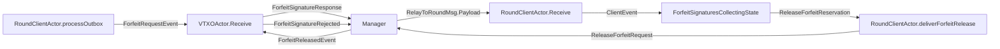
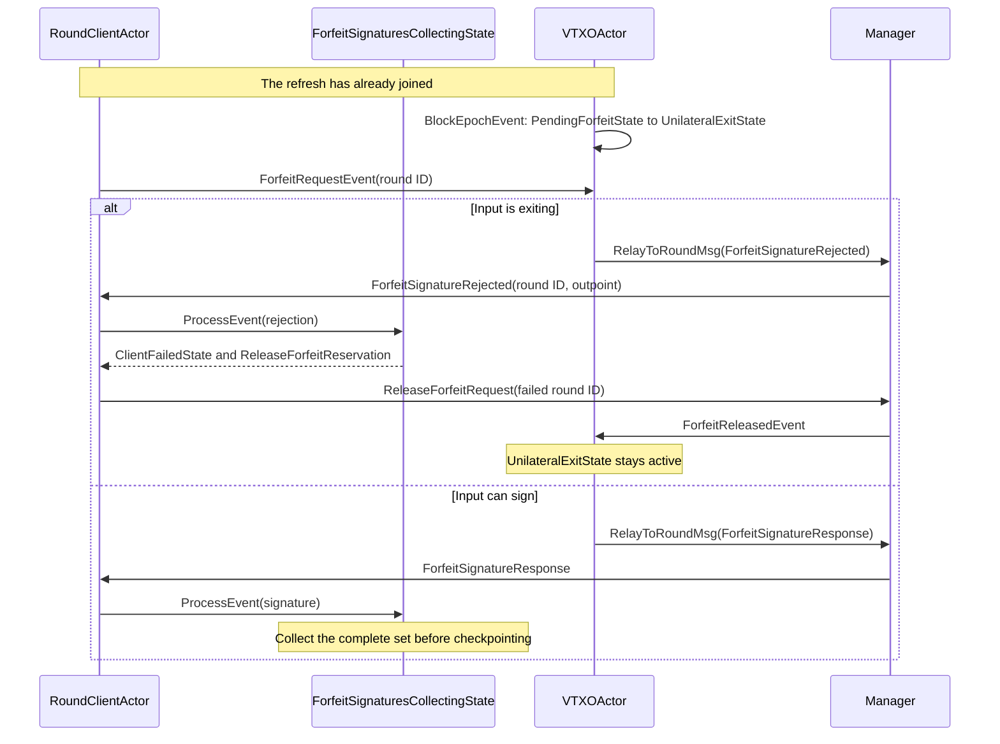
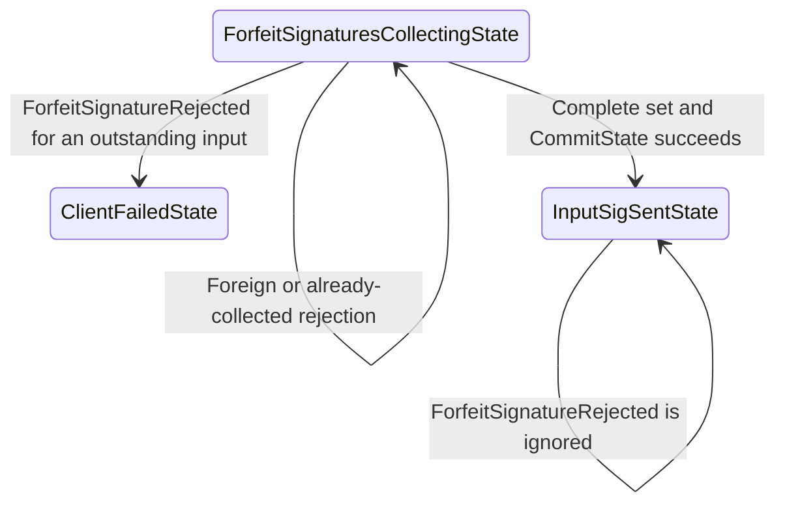

# Round input ownership

A round owns its expected signatures. Each VTXO actor owns whether its input can still sign. This document describes their handoff in the fix for #1557, based on `c30beaae` plus that fix. It covers expiry after joining and the local rejection path. See [accepted round deadlines](round_admission_deadlines.md) for the broader attempt lifetime.

## Components

The request goes directly to the input actor. Both its signature and its refusal return through the manager.

The refusal names the round and outpoint from the signing request. An outpoint-only expiry notice would be too weak: delayed delivery could stop a later reclaim attempt using the same input.

| Component | Owns | Does not own |
| --- | --- | --- |
| `VTXOActor` | Input state, expiry decisions, signing and status persistence | Round completeness or aggregate submission |
| `Manager` | Child lookup, reservation cleanup and message forwarding | Authority to stop a round |
| `RoundClientActor` | Routing by round ID and dispatching the round's outbox | Authority to undo an input's exit |
| `ForfeitSignaturesCollectingState` | Expected inputs, collected signatures and the decision to checkpoint | Child state or unilateral exit work |

## Expiry after joining

Critical expiry can take an input into exit after the client sent its join request. The signing handoff checks what the input can do when the request actually reaches it.

1. **Exit.** `PendingForfeitState.handleBlockEpoch` selects `UnilateralExitState`. `VTXOActor` persists the status and sends `ExpiringNotification` to the chain resolver.
2. **Refuse.** `UnilateralExitState.ProcessEvent` returns `ErrExitInFlight` for a forfeit request. `VTXOActor.Receive` relays `ForfeitSignatureRejected`. The refusal applies to the explicit exit-in-flight result. Other signing errors keep their existing handling.
3. **Check.** `RoundClientActor` routes the result by its exact round ID. The collecting state checks the expected-input set and ignores a refusal for an input whose signature it already has.
4. **Stop.** A valid refusal moves collection to `ClientFailedState`, cancels its collection timer and uses the existing rollback path. No signature checkpoint or aggregate submission is produced by this transition.
5. **Release.** The manager attempts each input's cleanup. An exiting input stays in exit. A peer that signed only locally can release its reservation under the failed round's existing ownership fence.

A refusal is not a command to cancel the unilateral exit. It only says that this cooperative attempt cannot get a complete set of signatures.

## The checkpoint boundary

The client commits `InputSigSentState` before sending its complete input signature set to the operator.

Locally collected signatures can be discarded before that checkpoint. After it, the operator may be able to complete the round. A local refusal or timeout cannot authorize releasing those obligations; confirmation and operator-status reconciliation still decide their outcome.

## Storage and concurrency

This path adds no stored fields. The input's existing status records its exit. `MarkForfeiting` retains a locally signed forfeit and its round binding. `CommitState` records the round before the signature-bearing outbox is sent.

| Owner | Mutable state |
| --- | --- |
| VTXO actor receive loop | Per-input state and signing result |
| Manager receive loop | Child references and cleanup routing |
| Round actor receive loop | Round registry and message routing |
| Round FSM driver | Expected/collected signatures and state transitions |
| `timeout.Actor` | Retained notification and cleanup retries |

`deliverManagerNotification` uses the existing nonblocking send and timeout retention path under mailbox pressure. Its detached context lets the result outlive the request turn. Round cleanup uses the existing retained `deliverForfeitRelease` path too. Neither path adds a synchronous round-to-manager wait.

The collecting FSM owns the final check. A delayed refusal cannot move `InputSigSentState` back to a releasable state, and a duplicate refusal cannot revive or release a failed attempt again.

## Limits

- This path fails the attempt when signing is refused. It does not cancel the round at the earlier moment an input starts exiting.
- Missing delivery or an unresponsive input still falls back to the existing collection/admission timers.
- Terminal input states that silently ignore signing requests remain outside this expiry fix.
- Scheduling policy, unilateral transaction relay and operator recovery are separate paths.
