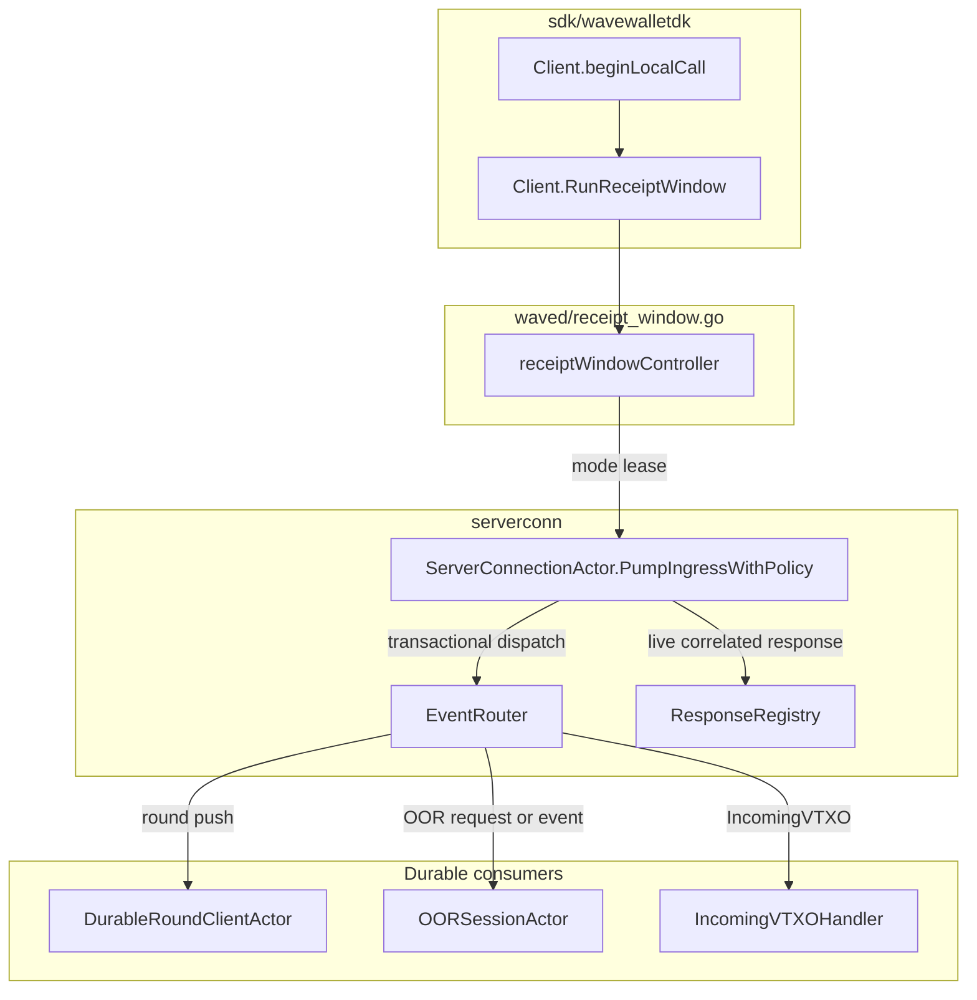
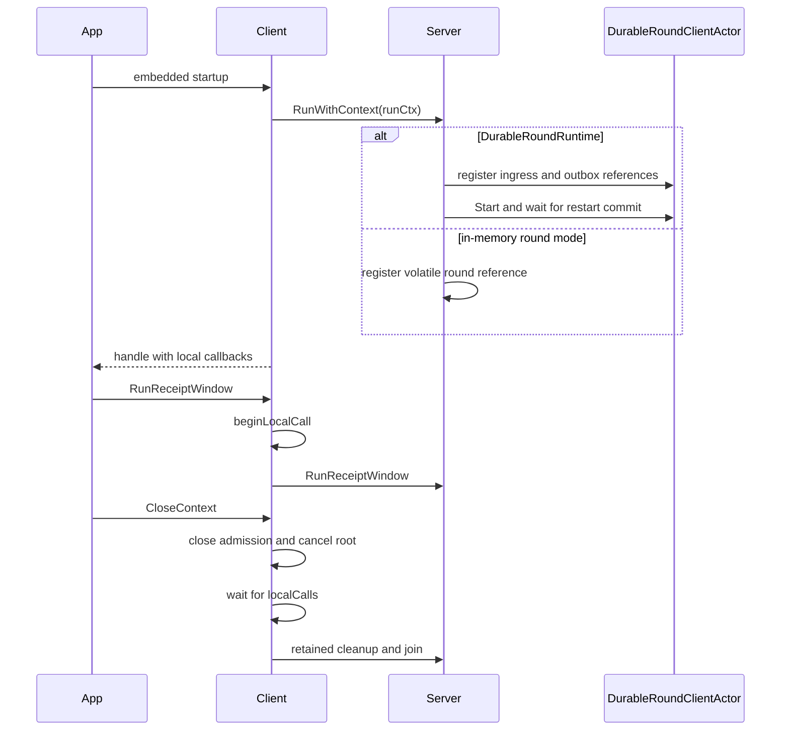
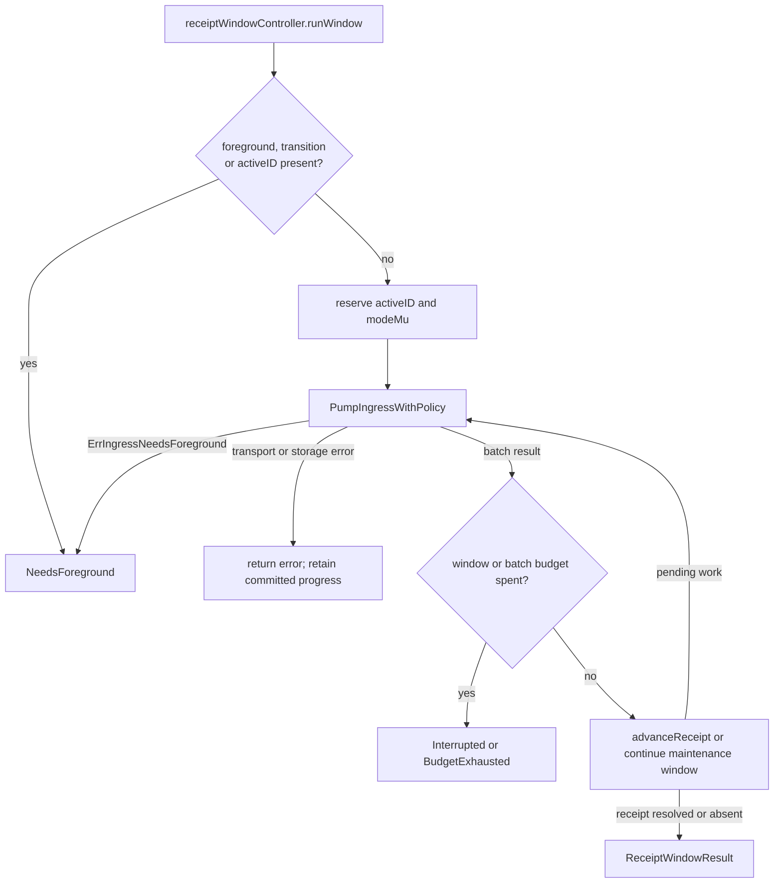
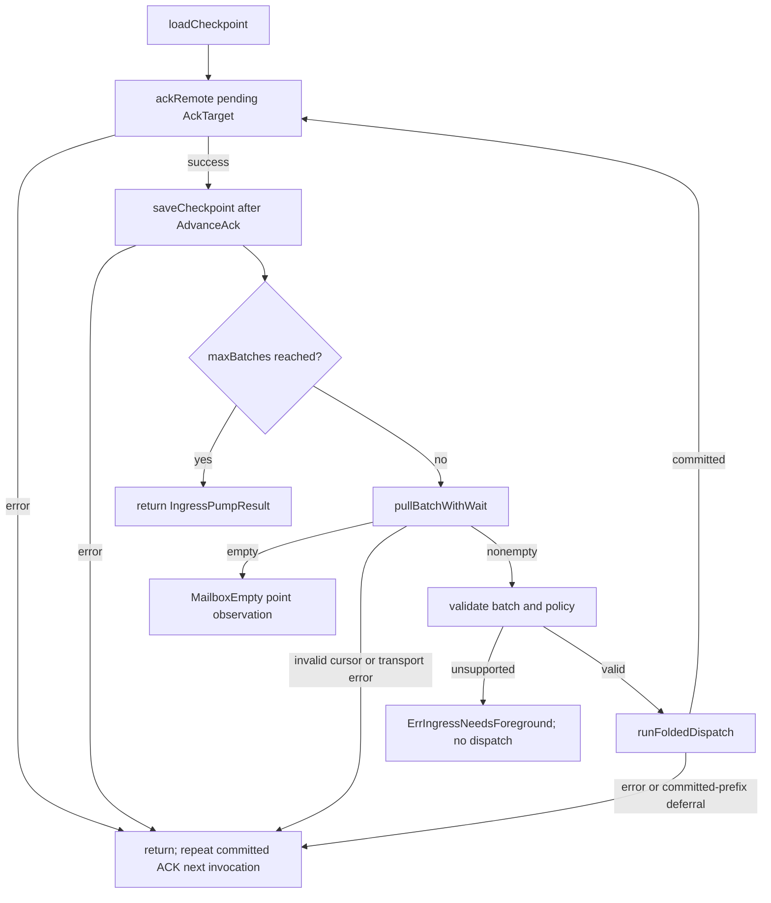
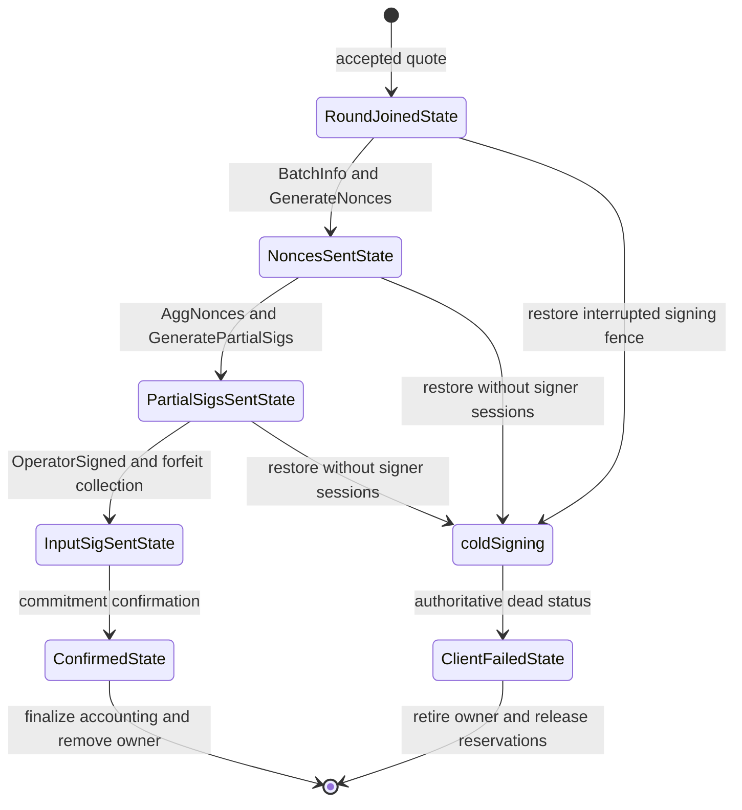
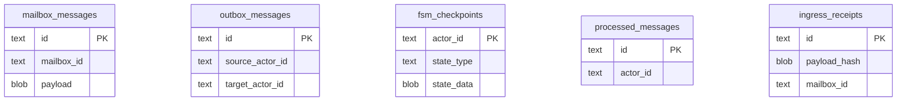

# SDK Wake Ingress Architecture

The embedded SDK turns remote mailbox envelopes into local recoverable work.
This document maps intake ownership, transaction boundaries and restart behavior
at `fc8cb86243ba529b4c4c5997e59d03a683e7da16`. Its scope is
`sdk/wavewalletdk`, `waved`, `serverconn`, durable round and OOR consumers,
and incoming VTXO materialization. A committed handoff is distinct from a
committed domain result and from delivery of its external effects.

See [host-driven ingress](host-driven-ingress.md),
[round runtime ownership](mobile_round_runtime_architecture.md),
[OOR sessions](oor_subsystem.md), and
[SDK shutdown](sdk-shutdown-ownership.md) for the underlying contracts.

## Components

The SDK retains the embedded daemon while a direct callback runs. The intake
owner serializes remote polling; domain actors consume their local inboxes
independently.

The diagram separates intake from execution. A return from `Tell` to a durable
consumer establishes inbox admission, not completion of that consumer's turn.

| Component | Owns | Does not own |
| --- | --- | --- |
| SDK `Client` | Callback admission, cancellation root, retained cleanup and callback join count | OS execution time or domain completion |
| `receiptWindowController` | Foreground/window exclusion, active window ID and cancellation | Wallet unlock, cold startup or domain shutdown |
| `ServerConnectionActor` | Intake lease, remote cursor, dispatch checkpoint and ACK ordering | Completion of inboxes or outboxes downstream |
| `ResponseRegistry` | Process-local unary waiters and original request provenance | Recovery of a vanished caller |
| `EventRouter` | Decode, adaptation and typed service delivery | Execution of a domain state machine |
| `DurableRoundClientActor` | Round checkpoint, staged signing fence and durable effects | Persistence of private signer sessions |
| OOR `OORSessionActor` | Session snapshot, staged domain writes and transport/accounting handoffs | Remote acceptance of a queued ACK |
| `IncomingVTXOHandler` | Authenticated descriptor materialization and idempotent replay | Canonical Lightning receipt classification |

## Lifecycle

Embedded startup gives the daemon its own cancellation root. Published SDK
callbacks enter `beginLocalCall` before touching daemon state.

Round ingress references register before the durable runtime starts. The typed
service is `round-client-service`; the persisted mailbox identity is
`round-client`. Disabling durable mode when its checkpoint exists fails startup.
A short `CloseContext` deadline can stop that caller's wait while retained
cleanup continues to own the daemon until it exits.

## Host windows and intake

`receiptWindowController` grants a bounded intake lease while keeping domain
workers alive. `stateMu` reserves or cancels a window before `modeMu` can block.
A foreground transition cancels a window before joining its lease.

The current window has a 20-second ceiling and a 32-attempted-batch ceiling.
Maintenance initially receives at most four seconds. These are SDK budgets,
not promises that iOS grants that much runtime.

The window's payment result comes from a targeted canonical receipt read.
An empty remote pull is not a completion barrier: direct transport, domain
workers and previously queued effects can still commit afterward.

### Remote dispatch and ACK

`PumpIngress` loads one checkpoint session, flushes a pending remote ACK,
then pulls a bounded batch. Its result counts attempted batches, including a
batch rejected by policy or stopped by an error.

The ACK phase precedes the batch-limit check. A successful single-batch pump
therefore ACKs its committed prefix before returning, without performing a
second pull. A dispatch deferral can commit a prefix and return before ACK;
the next invocation reloads and acknowledges that prefix.

1. **Validate.** `runFoldedDispatch` checks versions and the invocation policy
   before delivering any live waiter or nontransactional request.
2. **Partition.** Live correlated responses and explicitly marked
   nontransactional requests run outside the folded write transaction.
3. **Commit.** Durable inbox handoffs, event-occurrence receipts and the
   advanced dispatch/pull checkpoint share a transaction. A full destination
   mailbox stops progress before its undelivered envelope.
4. **Acknowledge.** `ackRemote` uses loaded or committed checkpoint state.
   If remote ACK succeeds but saving its local completion fails, repeating
   that ACK is safe.

Poison envelopes can be retained in `ingress_quarantine` with their original
payload and reason. Unknown routes can be skipped. Neither behavior proves
that every future route is suitable for background execution.

## Route ownership

The table lists registrations at the anchor, not an automatic background
allowlist. Durable round handling additionally requires `DurableRoundRuntime`.

| Wire route | Destination or special boundary |
| --- | --- |
| `OORMailboxService.SubmitPackage`, `FinalizePackage` | Durable OOR registry and session routing |
| `IndexerService.ListVTXOsByScripts`, `ListOORRecipientEventsByScript` | Live unary waiter first, otherwise OOR correlation adapter |
| `ArkService.IncomingOOR` | Durable OOR registry |
| `ArkService.IncomingVTXO` | Durable incoming VTXO consumer |
| `JoinAck`, `JoinRoundQuote`, `BatchInfo`, `AwaitingInputSigs`, `AggNonces`, `AggSigs`, `RoundFailed`, `Error`, `RoundStatusReport` | Typed round service; durable wire capture when enabled |
| `DaemonService.GetInfo` | Explicit nontransactional request dispatcher |

A live `KIND_RESPONSE` waiter takes precedence over the durable route. The
restricted receipt policy allows the two indexer response methods only when
the original registered request has matching provenance. `GetInfo` requests
are rejected by that policy. Ordinary round sends use
`SendClientEventRequest`, not a unary waiter.

`AwaitingInputSigs` adapts to `AwaitingBoardingSigs`. The current FSM has no
explicit transition for that compatibility event. Receiving it is not proof
that signatures were submitted.

## Domain commits and restart

Remote intake commits ownership before the domain worker consumes its inbox.
The domain commit has its own safety and recovery rules.

### Round turns

The round worker stages a before-image, encoded input and signing-attempt
fence before signer work. Final `Commit` groups round/VTXO writes, checkpoint,
outbox messages, actor inbox consumption and processed identity.

The diagram omits intermediate validation states; it shows signing ownership.
Private MuSig2 sessions are excluded from snapshots. A cold signing attempt
cannot create replacement nonces or re-sign. It keeps ownership until
reconciliation permits retirement. `InputSigSentState` can restore saved
boarding signatures and confirmation watches without restoring nonce sessions.
Durable join effects persist `SupportsRoundRetry: false` before publication.

### OOR sessions and incoming VTXOs

OOR session turns commit staged domain writes, the session snapshot and durable
transport/accounting handoffs with actor input consumption. An outgoing OOR
ACK can be durably queued before it reaches the peer. Local completion is not
remote confirmation.

Incoming VTXO processing authenticates ancestry and expiry before its first
write. It saves or reloads the descriptor idempotently, sends a best-effort
manager notification, then consumes its actor input. A crash between those
steps replays against the stored descriptor. Manager startup reconstructs
recoverable VTXO actors from persisted descriptors, including when that
notification did not arrive. Replay preserves a stored terminal status.

A generic incoming VTXO is not proof for a Lightning banner. Targeted receipt
sources are `lightning_swap` and `credit_receive`; amount and completion must
come from their canonical local state.

## Storage

Both SQL backends implement the same durable delivery interfaces. Process-local
waiters and private signing sessions remain outside those interfaces.

| State | SQLite | PostgreSQL |
| --- | --- | --- |
| Actor inbox, outbox, checkpoint and processed identities | `actordelivery` SQL tables | Same logical SQL tables |
| Remote ingress checkpoint | Delivery-store checkpoint | Delivery-store checkpoint |
| Occurrence receipt and quarantine | `ingress_receipts`, `ingress_quarantine` | Same logical SQL tables |
| Round/OOR/VTXO domain state | Domain stores joining transaction context | Domain stores joining transaction context |
| Unary waiter and signer-private session | Process memory | Process memory |

The schema excerpt shows identity fields relevant to this boundary. It omits
lease, retry and domain columns. There are no foreign keys connecting these
delivery identities; mailbox/actor names route work and are not parent rows.

An occurrence receipt survives deletion of its consumer inbox row. The receipt
fingerprint rejects the same delivery identity with different payload bytes.
It is transport replay evidence, not a canonical payment receipt or a global
idle marker.

## Concurrency

| Owner | Mutable state and lifetime |
| --- | --- |
| SDK `CloseContext` and retained cleanup goroutine | Close callback admission, wait for `localCalls`, then tear down embedded resources |
| Host window caller under `modeMu` | Intake mode lease and bounded invocation; `stateMu` protects cancellation/admission |
| Foreground ingress loop or pump | Exclusive connector intake lease and remote checkpoint session |
| Durable round worker | Round maps, quotes, timers, routing indices and per-turn configuration |
| Bounded signer workers | Independent signer jobs; results rejoin the round owner before map mutation |
| OOR session worker | Serialized session FSM and staged commit work |
| Incoming VTXO worker | Materialization retries and input consumption |
| Outbox delivery workers | Already committed effects; independent of the remote pull result |

Round timers and asynchronous replies enter the owning actor rather than
mutating its maps concurrently. A caller timeout does not roll back a committed handoff
or a turn that already committed. Cancellation must join the current intake
owner before another foreground loop or pump starts.

## Known gaps

- No current result proves global idle, safe suspension or that all downstream
  effects were delivered. `MailboxEmpty` is one remote observation.
- The pump result alone cannot establish `awaiting_peer`. That requires domain
  ownership and outstanding-effect evidence beyond the cursor.
- The route inventory does not justify removing restrictions for unknown,
  volatile or newly added handlers.
- Private signer sessions cannot survive process death. Persistence prevents
  nonce reuse; it does not guarantee completion of an interrupted ceremony.
- OS wake scheduling, available execution time, round deadline reminders and
  physical-device delivery require separate runtime evidence.
- This source audit did not run a fresh device or daemon integration test. It
  does not cover every unroll or wallet-worker state machine.
